# Safe-Box Envelope Encryption & Session Key Architecture

Code baseline: `master` @ `7f968e8` (2026-10-21, includes MR T = #298 `80a5900`). Since the previous baseline (`1730230`) `master` gained: #280 (the API 28–29 credential split, issue #279 — now merged, §3.7), #294 (`login_success` with `login_method` / `login_count`, `LoginMethod` enum — §8), #295 (`docs/analytics/firebase-setup.md`: GA custom-definition register, BigQuery export, the Param Registration Rule — §8.1, §9.0), #291 (26 locales — every new string goes through the localization skill), #278 (in-app updates), #283/#286/#284 (UI, screenshots). Room schema is still **5**, `BACKUP_VERSION` still **3**, last release tag `v2.1.4.0` with `v2.2.5.0` at rc7. Platform facts verified against Android 35 SDK sources and `androidx.biometric:1.1.0`.

> [!IMPORTANT]
> **Status: design & implementation plan.** Built so far: **MR T** (telemetry patch, #298, merged 2026-10-21), **MR 0** (this document, the `/scratch/` ignore rule and the spike record [ADR-0011](../decisions/0011-envelope-encryption-spike-results.md), 2026-10-21), **`minSdk` 29** (#301, [ADR-0012](../decisions/0012-min-sdk-29.md)), and **MR 1** (cryptographic core & seams, §9.3). **`minSdk` is 29 on `feature/envelope-encryption`**: every API 24–28 branch is gone from this copy of the document; `master` keeps `minSdk` 24 until the final merge, so its copy still carries them.
> - **Part I (§1–§5):** Architecture — cryptography, components, Room schema v6, backup format v4.
> - **Part II (§6–§8):** User & system flows (every diagram), UI changes, analytics and diagnostics.
> - **Part III (§9–§13):** the telemetry patch that ships first (§9.0), MR-by-MR plan (`MR 0`–`MR 9`), spike checklist, automated tests, manual test plan, debt register.
> - **Part IV (§14–§15):** Key decisions, what was ruled out, and the working rules for the effort.
>
> **The spike changed four things** (details and evidence in ADR-0011; the sections below carry the measured values): (1) platform PBKDF2 is pure-Java BouncyCastle and ~40–100× slower than §2.4 assumed, so the iteration counts were re-decided (§2.4: ≈ 100 000 SHA-256 within 500 ms on the Pixel 6a, no native KDF); (2) `T` stays **5 s** — the 3 s floor is rejected by the measured P99 (§2.3); (3) the migration needs **determinate** progress — 2.5 ms per legacy field on the Pixel 6a (§6.4); (4) `androidx.core` ≥ 1.18 stubs `FingerprintManagerCompat`, so with `androidx.biometric:1.1.0` biometric login was unavailable on API 24–28 in production (#299) and the fingerprint half of S1 could only be measured by pinning core 1.17 — moot on this branch since `minSdk` 29 (§3.7).

---

# Part I — Architecture

## 1. Problem, Objectives & Threat Model

### 1.1 Today
[SecurityModule.kt](../../app/src/main/java/com/andryoga/safebox/di/SecurityModule.kt) provides a `@Singleton` AES-256-GCM `SecretKey` (`symmetricDataKey`, `setUserAuthenticationRequired(false)`) that [SymmetricKeyUtilsImpl.kt](../../app/src/main/java/com/andryoga/safebox/security/SymmetricKeyUtilsImpl.kt) uses for every field of the **six** secure DAOs (login, bank account, bank card, secure note, authenticator/TOTP, user-details hint). Login is a boolean gate (`checkPassword` → `navigateRoot(HomeGraph)`). Anything executing inside the process — a patched APK, a hijacked navigation route — reads plaintext. A second, silent failure mode: if the Keystore alias vanishes, `getSymmetricKey()` regenerates it and every record becomes permanently undecryptable. A third: `decrypt()` has no error handling, so a single unreadable row breaks the list that contains it.

### 1.2 Objectives
1. **No ambient key.** Records are decryptable only with a Data Encryption Key (DEK) that exists on disk solely in *wrapped* form, each wrap openable only by (a) the master password, (b) a Class-3 biometric, or (c) the device lock-screen credential — the last two enforced by Keystore hardware, not by app code.
2. **Session key in RAM only**, held by `SessionKeyHolder`, best-effort zeroed on lock.
3. **Bypass yields nothing.** Reaching `HomeGraph` without an unlock reroutes to `LoginGraph`; any data-layer call while locked fails closed with `SessionLockedException` and **never crashes the app**.
4. **Zero data loss from Keystore failures.** The password wrap never depends on Keystore; every Keystore-backed wrap is disposable and silently recreated.
5. **Recoverability is not worse than today** for anyone who has a lock screen while signed in.
6. **The upgrade never locks a user out and never loses a readable record** (§6.4.2).

### 1.3 Threat Model Matrix

| Scenario | Today | Envelope Architecture (v2) |
|---|---|---|
| Copy of `/data/data` without the device | ciphertext (key in Keystore) | ciphertext; password wrap attackable only at full KDF cost |
| Copy of a `.bak` backup file on external/cloud storage | **1 324 × SHA-1, AES-CBC, no integrity, shared IV** | **v4: the §2.4 KDF (≈ 100k × SHA-256), AES-256-GCM, authenticated header (§5.2)** |
| On-device code execution without any credential (patched APK, navigation bypass) | **plaintext** | ciphertext |
| Attacker knows the device PIN | can reset master password via forgot-password → plaintext | same floor (`KEK_Device`) — unchanged by design |
| Rooted device / Frida while unlocked | plaintext | plaintext — out of scope for any app-side design |
| Phishing prompt / keylogged password field in a patched APK | plaintext | plaintext — out of scope |
| Keystore alias lost (OS bug, OEM transfer) | **total silent data loss** | no loss: password wrap + silent recreation of the others |
| Android 10 only: patched app running within `T` = 5 s of a phone unlock | plaintext anyway | can unwrap the DEK (time-bound `KEK_Device`, §2.3) — residual, disclosed |
| Decrypted plaintext already in ViewModel state when the away-timeout fires | stays in RAM behind a dialog | navigation to Login drops the Home back stack; the key is zeroed |

### 1.4 Residual Risks & Explicit Non-Goals
1. **Android 10 (API 29):** `KEK_Device` is time-bound; a patched app can unwrap within `T` of any phone unlock. Mitigation: `T` = **5 s** (§2.3), immediate unwrap, Play Console sizing (Android 10 was 4.9 % of the installed audience on 2026-10-21, [ADR-0012](../decisions/0012-min-sdk-29.md)). Not fixable on that API without dropping PIN recovery; whether recovery becomes API 30+ instead is decided at MR 6 from the `forgot_password_click` OS split (§9.0).
2. **Users with no lock screen at the moment they forget the password** have no recovery — true for *any* envelope design. Mitigation: silent wrap at the first unlocked session with a lock screen, the Home nudge (dismissable only by accepting the risk), honest UI, baseline from analytics.
3. **Plaintext in RAM while unlocked** (rooted device, Frida, memory dump) — out of scope.
4. **Phishing / keylogging inside a patched APK** — out of scope.
5. **Settings → change password** accepts a device authentication *or* the current master password. Same floor as the login-screen recovery.
6. **Legacy `.bak` files (v1–v3)** already in users' folders stay attackable at 1 324 iterations forever — nothing the app can do about copies it no longer holds. New backups written after MR 8 (#242) use v4.
7. **A user who chooses *Continue for now* after a failed upgrade** (§6.4.2) keeps today's security level until the upgrade succeeds — by design, because a lock-out is worse. Visible in analytics (`VAULT_MIGRATION_CONTINUE_LEGACY_CLICK`).
8. **Session paused** (`setPaused(true)` during SAF pickers) keeps the DEK in RAM — ADR-0005, unchanged.
9. **`EncryptedSharedPreferences` `MasterKey`** keeps the lost-alias failure mode for `IS_SIGN_UP_REQUIRED`; mitigated by Room-first routing (§3.6).
10. **Password-wrap work factor below OWASP's 2023 minimum.** The platform PBKDF2 is pure Java (ADR-0011 S6/S10), so the 500 ms budget buys ≈ 100 000 SHA-256 iterations instead of 210 000+ — accepted on 2026-10-21 over a native KDF dependency (§2.4). Mitigations: the master-password rules (≥ 7 chars, mixed case, ≥ 2 digits, a symbol), the per-wrap versioned `kdf_params` that let any later release raise the count or switch algorithm through the drift re-wrap, and the fact that the wrap is only reachable with a copy of the database.

---

## 2. Cryptographic Architecture & Key Hierarchy

### 2.1 Keys
Exactly **one data key** and **three key-encryption keys (KEKs)**. A *wrapped DEK* is not a key; it is the DEK encrypted and stored.

| Key | Type | Lives in | Opens | Created | Dies |
|---|---|---|---|---|---|
| **DEK** | AES-256 (32 random bytes) | RAM only (`SessionKeyHolder`); on disk only as the three wraps | every record field + verifier | signup / migration, **never rotated** by a password change | zeroed on lock, timeout, process death |
| **KEK_Password** | AES-256 derived by PBKDF2 from the master password | RAM for the duration of one unlock | `wrapped_dek_password` | re-derived on every password unlock | discarded immediately |
| **KEK_Biometric** | **RSA-2048 key pair**, AndroidKeyStore, per-operation, `AUTH_BIOMETRIC_STRONG`, invalidated by enrolment | TEE / StrongBox (private half never leaves) | `wrapped_dek_biometric` — private half only inside a `BiometricPrompt` + `CryptoObject` | silently, any unlocked session with a Class-3 biometric enrolled | new enrolment, lock-screen removal, user opt-out |
| **KEK_Device** | **RSA-2048 key pair**, AndroidKeyStore, `AUTH_DEVICE_CREDENTIAL or AUTH_BIOMETRIC_STRONG`; per-operation on API 30+, time-bound (`T` = 5 s) on 29 | TEE / StrongBox | `wrapped_dek_device` — private half only after a PIN/pattern/password or biometric authentication | silently, any unlocked session with a lock screen present | lock-screen removal |

**Why RSA for the Keystore KEKs.** Keystore's authentication requirement *"applies only to secret key and private key operations. Public key operations are not restricted"* (`KeyGenParameterSpec.java` L1451-1452). The **public half can only lock**: wrapping the DEK needs no prompt and reveals nothing. The **private half unlocks** and the hardware refuses to run it without a genuine authentication token. With symmetric AES keys both directions are gated and every wrap creation would need a prompt.

**Why two Keystore keys instead of one accepting both auth types.** The auth policy is a tag baked into the key at generation (`KM_TAG_USER_AUTH_TYPE`, `KeyStore2ParameterUtils.addSids()` L241-296). A credential-accepting key is bound to the lock screen's root SID and therefore can never be invalidated by a new fingerprint; and on API 29 it must be time-bound. Keeping the login key biometric-only and per-operation on every API confines the time-bound window to the recovery path on Android 10.

### 2.2 Key Specifications & Health Probe

```kotlin
// KEK_Biometric and KEK_Device share one builder; only alias and auth parameters differ.
KeyGenParameterSpec.Builder(alias, PURPOSE_ENCRYPT or PURPOSE_DECRYPT)
    .setKeySize(2048)
    .setDigests(DIGEST_SHA256, DIGEST_SHA1)              // SHA-1 listed only for MGF1 compatibility
    .setEncryptionPaddings(ENCRYPTION_PADDING_RSA_OAEP)
    .setUserAuthenticationRequired(true)
    .apply {
        when (spec) {
            BIOMETRIC -> {
                if (SDK_INT >= R) setUserAuthenticationParameters(0, AUTH_BIOMETRIC_STRONG)
                else setUserAuthenticationValidityDurationSeconds(-1)
                setInvalidatedByBiometricEnrollment(true)
            }
            DEVICE -> {
                if (SDK_INT >= R) setUserAuthenticationParameters(0, AUTH_DEVICE_CREDENTIAL or AUTH_BIOMETRIC_STRONG)
                else setUserAuthenticationValidityDurationSeconds(DEVICE_KEY_VALIDITY_SECONDS) // 5
            }
        }
        setIsStrongBoxBacked(true)                        // retried without on StrongBoxUnavailableException
    }
```

- **Wrap/unwrap cipher:** `RSA/ECB/OAEPWithSHA-256AndMGF1Padding` with an **explicit** `OAEPParameterSpec("SHA-256", "MGF1", MGF1ParameterSpec.SHA1, PSource.PSpecified.DEFAULT)` on both sides. Keystore pads with MGF1-SHA1 and Conscrypt defaults to MGF1-SHA256, so a wrap made with default parameters fails to unwrap on every API tested (24, 28, 30, 34, 35) — as `IllegalBlockSizeException` (cause `KeyStoreException`), not `BadPaddingException` (ADR-0011 S4).
- **Wrap with the JCA provider, never with the Keystore cipher.** Re-encode the public half (`KeyFactory.getInstance("RSA").generatePublic(X509EncodedKeySpec(pub.encoded))`) and encrypt with the default provider. The JCA path never touches Keystore and works on every API (S2; the API 24 Keystore cipher that refused the operation outright is below `minSdk` now, ADR-0011). On every supported level `Cipher.getInstance` already routes a Keystore public key to Conscrypt, so the explicit spec is what matters.
- **Size:** A 32-byte DEK fits RSA-2048-OAEP-SHA-256 (≤ 190 bytes). Ciphertext = 256 bytes.
- **Lazy creation:** Key generation requires a secure lock screen; the biometric key additionally requires an enrolled Class-3 biometric. Without them `generateKeyPair()` throws `InvalidAlgorithmParameterException` whose cause is the `IllegalStateException` ("Secure lock screen must be enabled…" / "At least one biometric must be enrolled…", API 34, S5) — catch the outer type. Both are created **lazily** (§6.5), never at a moment that would need a prompt.
- **Health probe without a prompt:** `keyStore.getKey(alias)` then `Cipher.init(DECRYPT_MODE, privateKey, oaepSpec)`, never `doFinal`. Measured outcomes (S2, S9):
  - Per-operation key: `init` returns (operation pending auth) on every API. On API 30 a new enrolment makes `init` throw `KeyPermanentlyInvalidatedException` as documented; the API 24 emulator instead left `init` succeeding and only `doFinal` failing after an invalidation (ADR-0011 S9) — below `minSdk` now, kept as the reason the rule stays defensive: a `doFinal` failure right after a *successful* prompt is also treated as *Invalidated*, not only the init-time exception.
  - Time-bound key (API 29): `init` throws `UserNotAuthenticatedException` (healthy), or returns when inside `T` of any authentication (healthy; discard). After a lock-screen reset it throws `KeyPermanentlyInvalidatedException` at `init` (observed on API 24, S9).
  - After the lock screen is removed (observed on API 28 and 30), `keyStore.getKey` itself throws `UnrecoverableKeyException` ("Failed to obtain information about key" / "User changed or deleted their auth credentials") while `containsAlias` stays true, and `deleteEntry` can then fail with `KeyStoreException: Failed to delete entry` (API 30). The gateway therefore maps *alias missing*, `getKey == null`, `UnrecoverableKeyException` and `KeyPermanentlyInvalidatedException` all to *recreate*, treats a failed delete as non-fatal, and generates the replacement under a **fresh alias** (suffix in `vault_meta`) rather than reusing a name that may be stuck.
  - A `doFinal` without authentication fails as `UserNotAuthenticatedException` for a time-bound key but as `IllegalBlockSizeException` (cause `KeyStoreException: Key user not authenticated`) for a per-operation key on every level tested (24–35): the fail-closed paths catch the general exception, not a specific class.

### 2.3 Authentication Binding of `KEK_Device` & Sizing `T`

| API | Key params | Prompt | What authorises the unwrap |
|---|---|---|---|
| 30+ | per-operation, `AUTH_DEVICE_CREDENTIAL or AUTH_BIOMETRIC_STRONG` | `BIOMETRIC_STRONG or DEVICE_CREDENTIAL` **with `CryptoObject(decryptCipher)`** (allowed from API 30, `BiometricPrompt.java` L949-953) | a token bound to *that cipher operation*. A phone unlock authorises nothing. |
| 29 | time-bound, `T` = **5 s** (crypto + credential is rejected below API 30) | plain `BIOMETRIC_WEAK or DEVICE_CREDENTIAL` (the only credential combination androidx 1.1.0 accepts there — #279), credential UI inside the framework prompt (`setDeviceCredentialAllowed`), unwrap **immediately** in the callback | any keyguard/biometric authentication in the last `T` seconds — including an ordinary phone unlock (Javadoc L1482-1484). This is the residual in §1.3. |

**What `T` covers on API 29:**

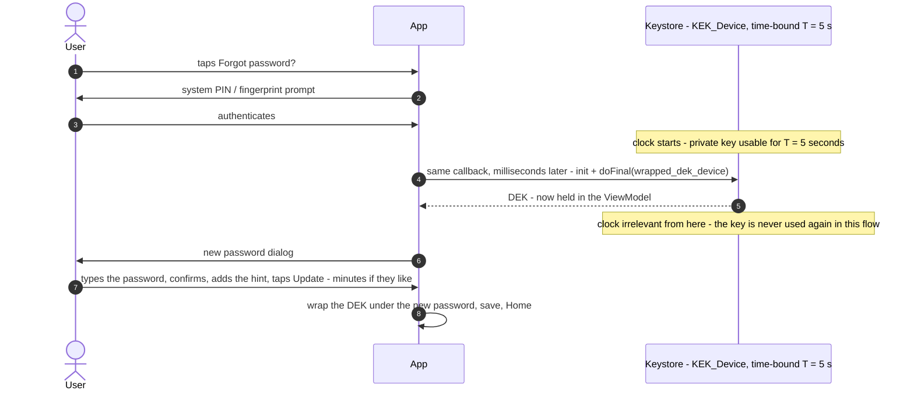

`T` is not a user-facing timeout. It covers step 4 only; the new-password dialog that follows is never timed. Because Keystore below API 30 cannot tell *which* authentication unlocked the key (`KeyGenParameterSpec.java` L1478-1484, Android 35 SDK sources), every ordinary phone unlock leaves the key usable for `T` seconds by code in the app's sandbox.

**Why 5 s and not 1 s.** Step 4 is not "a few milliseconds" end to end:

- On API 29 the PIN/pattern UI is **inside the framework prompt**: androidx 1.1.0 launches the separate `KeyguardManager` Activity (`createConfirmDeviceCredentialIntent`, `BiometricFragment` L804-824 → `onActivityResult` L251) only on API ≤ 28 (`isManagingDeviceCredentialButton()` is `SDK_INT <= P`; verified in the 1.1.0 sources, 2026-10-21). Gatekeeper stamps the authentication when the PIN is verified; what remains before our callback is the prompt's own dismissal and the fragment dispatch — the 300–800 ms of Activity transitions S1 measured on API 24/28 are the upper bound, not the API 29 path.
- Then the RSA-2048 private operation runs in the TEE (20–150 ms) or in StrongBox (up to ~500 ms on 2018–2019 StrongBox hardware; 306 ms on the Pixel 6a, S5).
- 1 s leaves no margin. The failure is not data loss but a **loop**: `UserNotAuthenticatedException` → prompt again → same latency → same exception, on exactly the 2018–2019 hardware that still runs Android 10. Recovery would be impossible for them.
- What a shorter `T` buys: **nothing against a resident attacker** — code already running in the sandbox simply polls after every unlock, and a phone is unlocked dozens of times a day; 1 s and 5 s both let it in. Only a one-shot attacker landing at a random moment is cut proportionally.

Decision: **5 s** (the 3 s floor is rejected). S1 measured the credential-Activity path end to end through androidx 1.1.0 (25 runs per level, animations on, ADR-0011): Enter-on-PIN → `doFinal` done was P99 **1 138 ms** on the API 24 emulator (median 339) and **635 ms** on API 28 (median 578), both above the 600 ms bar for 3 s — on a laptop-class host, before any hardware derating. Both levels are below `minSdk` since [ADR-0012](../decisions/0012-min-sdk-29.md); the API 29 in-prompt path is shorter and was not re-measured, so 5 s stands as a conservative value rather than a tuned one. The crypto itself is negligible (callback → `doFinal` ≤ 38 ms); the window is the Activity round-trip. The fingerprint path authorises the same key in ≤ 26 ms after the touch (API 24 through `FingerprintManager` and, with `androidx.core` 1.17, through the androidx dialog; API 28 through the framework prompt). The residual is confirmed as written: a plain keyguard unlock authorised the time-bound key within 5–23 ms on API 24, 28 **and 30** (S1/S3), which is why API 30+ uses the per-operation key.

### 2.4 Password KDF & Unicode Normalisation
- **Algorithm:** `SecretKeyFactory.getInstance("PBKDF2WithHmacSHA256")`, **256-bit output** in one block, 16-byte random salt, password as `CharArray` via `PBEKeySpec` (cleared with `clearPassword()`), UTF-8. `PBKDF2WithHmacSHA256` exists from API 26, so with `minSdk` 29 ([ADR-0012](../decisions/0012-min-sdk-29.md)) it is available everywhere; the `PBKDF2WithHmacSHA1` variant the design carried for API 24–25 is gone (a 256-bit output from SHA-1 costs two PBKDF2 blocks — S10: 930 vs 505 ms per 100 000 iterations on the Pixel 6a — so nothing is lost).
- **Iterations — decided 2026-10-21 (owner, after S6/S10 in ADR-0011): platform PBKDF2 at the latency budget, no native dependency.** On every API level the platform PBKDF2 is served by **BouncyCastle's pure-Java implementation** (BC 1.57 on API 28, 1.77 on 35); Conscrypt offers no PBKDF2. On the Pixel 6a, foreground, 256-bit output: **≈ 505 ms per 100 000 iterations** with SHA-256 (≈ 930 ms with SHA-1); the design's former floor (600 000) would take 5.2 s per login and is withdrawn. A hand-rolled PBKDF2 over Conscrypt's native HMAC is JNI-bound (≈ 300 ms per 100 000 `doFinal`) and would not change that.
  - **Budget:** ≤ 500 ms per derivation on the Pixel 6a (≈ 2 s on an entry-level core at ×4), paid once per password login and once per backup/restore.
  - **One algorithm, still named in `kdf_params`:** `PBKDF2WithHmacSHA256` at **`PBKDF2_ITERATIONS = 99_000`** — calibrated in MR 1 as the largest round count that measures ≤ 500 ms on the Pixel 6a with the S6/S10 method (504.5 ms median at 100 000 ⇒ 499.5 ms at 99 000). That is ≈ 75× today's 1 324 iterations; it is below OWASP's 2023 minimum (210 000 for SHA-256), which is accepted knowingly and recorded in §1.4.
  - **Ruled out:** a native KDF (Argon2id or PBKDF2 over the NDK) — rejected again for the native dependency, see decision 10; keeping the original counts — 5–11 s per login. Because `kdf_params` is versioned and the iteration-drift re-wrap (§6.3) re-derives at the next password login, either the count or the algorithm can be raised in any later release, including a later move to a native KDF.
- **`kdf_params` format:** `v1|<algorithm>|<iterations>|<base64 salt>` with `<algorithm>` exactly as passed to `SecretKeyFactory.getInstance` — always `PBKDF2WithHmacSHA256` today; the field stays so that a later algorithm change is a new value plus the drift re-wrap, not a new format version. A reader that does not recognise the version or the algorithm fails closed.
- **Salt isolation:** the vault's salt is never shared with anything else on disk; backup format v4 (§5.2) reuses the `PasswordKdf` code and the iteration constant with its own fresh 16-byte salt per file.
- **Unicode normalisation — NFKC:** `Normalizer.normalize(password, Normalizer.Form.NFKC)` (API 9+) is applied **exactly once, inside `PasswordKdf`**, before the characters reach `PBEKeySpec`. Two paths deliberately bypass NFKC because their stored material predates the rule: the legacy `compareHash` during migration (§6.4) and the v1–v3 backup reader (§5.3).

| User sees | Keyboard A sends | Keyboard B sends | Without NFKC | With NFKC |
|---|---|---|---|---|
| `Café#24` | `é` = U+00E9 → `C3 A9` (Gboard, most IMEs) | `e` + U+0301 combining accent → `65 CC 81` (dead-key keyboards, macOS paste) | different keys ⇒ "Incorrect password" | both → U+00E9 ⇒ same key |
| `pass123` | ASCII `pass123` | full-width `ｐａｓｓ１２３` = U+FF50… (CJK IME in full-width mode) | different keys | full-width → ASCII ⇒ same key |
| `finance1` | `finance1` | `finance1` with `fi` ligature U+FB01 (autocorrect / paste) | different keys | `fi` → `fi` ⇒ same key |

### 2.5 Blob Formats & `dek_verifier`
All blobs are stored as Base64 text in `vault_meta.value`:

| Blob | Format | How a wrong key is detected |
|---|---|---|
| `wrapped_dek_password` | `0x01 ‖ iv(12) ‖ AES-256-GCM(KEK_Password, DEK, aad = "safebox.wrap.password.v1")` | GCM tag — wrong password ⇒ `AEADBadTagException` |
| `wrapped_dek_biometric` | `0x01 ‖ RSA-OAEP(KEK_Biometric.pub, DEK)` (256 bytes) | **cannot be detected by the wrap itself** → `dek_verifier` |
| `wrapped_dek_device` | `0x01 ‖ RSA-OAEP(KEK_Device.pub, DEK)` | **cannot be detected by the wrap itself** → `dek_verifier` |
| `dek_verifier` | `0x01 ‖ iv(12) ‖ AES-256-GCM(DEK, "safebox.dek.verifier.v1", aad = "verifier")` | decrypt + compare; written once per DEK |

**Why `dek_verifier` exists — in plain terms.** The password wrap is AES-GCM: a wrong password fails the tag and the app *knows*. The two RSA wraps have no such property. Hardware RSA-OAEP decrypts **any** blob that was encrypted with the matching public key, and that public key is readable by anyone in the process without authentication. So an RSA wrap can be perfectly *valid* and still contain the *wrong* DEK — a bug that wrapped a stale DEK (a race between erase/re-signup and `runAfterUnlock`), a `vault_meta` row copied from another vault, or deliberate tampering. The hardware cannot tell; only the app can, by testing the candidate DEK against something only the real DEK opens. That is `dek_verifier`: a constant string encrypted once under the real DEK. `verify()` decrypts it with the candidate; a tag failure means "this is not this vault's DEK".

Where it matters most: forgot-password recovery is the only flow that **writes** `wrapped_dek_password` from a DEK obtained through an RSA wrap.

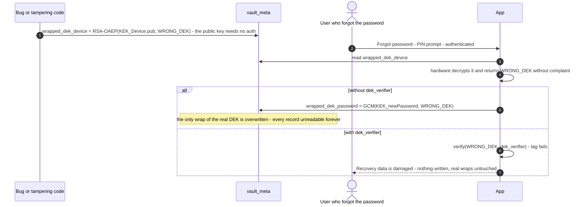

The check is one AES-GCM decrypt of 24 bytes — microseconds — and it runs on **every** unwrap (password, biometric, device) so a wrong DEK can never propagate into new wraps through `runAfterUnlock` either. What it is not: a defence against code that reads the DEK from RAM while the vault is open (out of scope, §1.4).

Record fields keep today's on-disk format (`b64(ct)|b64(iv)`, AES-256-GCM); only the key changes.

### 2.6 Storage Map

| Medium | Contents | State |
|---|---|---|
| Room `vault_meta` (schema v6) | `crypto_version`, `kdf_params`, `wrapped_dek_password`, `wrapped_dek_biometric`, `wrapped_dek_device`, `dek_verifier`, `biometric_unlock_disabled`, transient `legacy_password_hash` | ciphertext / public parameters; useless without an opener |
| Room `quarantined_record` (schema v6) | rows the migration could not read under the legacy key, kept as they were (§4.4) | ciphertext under the legacy key |
| Room record tables + `user_details.hint` | records under the DEK; **hint in plaintext** (`crypto_version = 2`) | |
| AndroidKeyStore | `KEK_Biometric`, `KEK_Device` private halves; legacy `symmetricDataKey` until migration (kept while `quarantined_record` is non-empty) | hardware-isolated, auth-gated |
| `EncryptedSharedPreferences` | `IS_SIGN_UP_REQUIRED` | unchanged; advisory only (§3.6) |
| `SettingsDataStore` | `ALLOWED_BIOMETRIC_LOGIN_COUNT_REMAINING`, `PASSWORD_AFTER_X_BIOMETRIC_LOGIN`, `SCREEN_LOCK_NUDGE_DISMISSED`, `VAULT_MIGRATION_ATTEMPTS`, folders, flags | **no key material** |
| WorkManager DB | work ids only | **no password material** (§5.1) |
| RAM | `SessionKeyHolder` buffer; per-work-id backup passwords | zeroed on lock |

### 2.7 Cryptographic & System Parameters

| Parameter | Value | Source |
|---|---|---|
| DEK size | 32 bytes | fixed |
| RSA key size | 2048 bits | fixed |
| `DEVICE_KEY_VALIDITY_SECONDS` (API 29) | **5 s** (3 s rejected: credential-Activity P99 1 138 ms on API 24, 635 ms on API 28 — the upper bound for the in-prompt path of 29) | §2.3; ADR-0011 S1 |
| `PBKDF2_ITERATIONS` (`PBKDF2WithHmacSHA256`) | **`99_000`**, calibrated in MR 1 as the largest round count that measures ≤ 500 ms on the Pixel 6a — platform PBKDF2 is BouncyCastle at 504.5 ms median per 100 000 | §2.4; S6/S10 |
| Timing reference device | **Pixel 6a** (Tensor, TEE + StrongBox), Android 15; entry-level budgets derated ×4 | S5–S7, S10 |
| Password normalisation | **NFKC**, once, inside `PasswordKdf` | §2.4 |
| KDF salt | 16 bytes | fixed |
| GCM IV / tag | 12 bytes / 128 bits | fixed |
| `BACKUP_VERSION` | **4** (today 3, raised by #241) | §5.2, #242 |
| Migration free-space precheck | available ≥ 2 × DB file size + 16 MB (measured peak WAL **0.98 × DB**, API 24 and 34) | §6.4.2; S7, S11 |
| Migration field-decrypt retries | 3, backoff 100 / 300 / 900 ms | §6.4.2 |
| Migration progress mode | **determinate** — 2.5 ms per legacy field on the Pixel 6a: 100 records 1.4 s, 500 records 7.3 s, 2 000 records 27 s | §6.4; S7 |
| Legacy field decrypt vs DEK field decrypt | 2.5 ms (Keystore round-trip) vs 0.06 ms in-process; a 2 000-record list reads in 0.6 s instead of 25 s | S7 |
| RSA keygen | TEE: 0.8 s median, 1.5 s max; **StrongBox: 5.2 s median, 18–20 s max** (Pixel 6a) | S5 |
| RSA private unwrap | TEE 36 ms; StrongBox 306 ms; probe (`init` only) 8 / 37 ms (Pixel 6a) | S5 |
| CI image (`aosp-atd`) | **no secure lock screen** — `locksettings` is ignored and auth-bound keys cannot be generated | S8 |

---

## 3. Components & Interfaces

All security interfaces live in `com.andryoga.safebox.security.interfaces`, import **no androidx/UI types**, and are JVM-unit-testable through the `KeystoreGateway` seam. Hilt-provided, `@Singleton` unless noted. `DispatchersProvider` injected everywhere; no hardcoded dispatchers.

### 3.1 `SessionKeyHolder`

```kotlin
interface SessionKeyHolder {
    val isUnlocked: Boolean                    // Unlocked or LegacyUnlocked
    val isLegacySession: Boolean               // true only after Continue for now (6.4.2)
    val lockEvents: SharedFlow<Unit>
    /** @throws SessionLockedException when locked. The returned key is a short-lived copy of the DEK,
     *  or the non-exportable Keystore handle of the legacy key in a legacy session. */
    fun <T> withSessionKey(block: (SecretKey) -> T): T
    fun setSessionKey(dekBytes: ByteArray)     // copies, caller zeroes its own array
    fun setLegacySession(legacyKey: SecretKey) // fallback only: the legacy Keystore handle, no key material
    fun clearSessionKey()                      // zero-fills the buffer, drops the handle, emits lockEvents
}
class SessionLockedException : SecurityException("Vault is locked")
```

Implementation: a single `@Volatile` state (`Locked` / `Unlocked(ByteArray)` / `LegacyUnlocked(SecretKey)`) guarded by an atomic reference; `withSessionKey` builds a `SecretKeySpec` per call for the DEK (the spec clones bytes — zeroing the holder does not break in-flight ciphers). The claim is **best-effort zeroing of the holder's own buffer**; `SecretKeySpec`, Conscrypt and process death are outside its control. Thread-safe from Main, Default and WorkManager threads. The data layer never knows which state it is in: `SymmetricKeyUtils` asks the holder for a key and gets the DEK or the legacy handle.

### 3.2 `KeystoreGateway` (the fakeable seam)

```kotlin
enum class WrapKeySpec { BIOMETRIC, DEVICE }
sealed interface KeyHealth { object Healthy : KeyHealth; object Missing : KeyHealth; object Invalidated : KeyHealth }

interface KeystoreGateway {
    fun generateWrapKeyPair(alias: String, spec: WrapKeySpec): PublicKey
        // throws LockScreenRequiredException / BiometricNotEnrolledException (mapped from IllegalStateException)
    fun publicKey(alias: String): PublicKey?
    fun decryptCipher(alias: String): Cipher          // init(DECRYPT, oaepSpec); may throw UserNotAuthenticatedException
    fun probe(alias: String): KeyHealth               // §2.2 health probe, no prompt
    fun deleteKey(alias: String)
    fun legacyVaultKey(): SecretKey?                  // "symmetricDataKey" or null — NEVER regenerates
    fun deleteLegacyVaultKey()
}
```

`AndroidKeystoreGateway` is the production binding; `FakeKeystoreGateway` (JVM) uses plain JCE RSA pairs with a settable auth/invalidated state, so the full OAEP wrap/unwrap path runs in unit tests. The androidTest module binds the fake too (replacing `TestDeviceSecurityModule`'s role for crypto); the real gateway is exercised by the instrumentation suite in §11.

### 3.3 `EnvelopeEncryptionManager`

```kotlin
interface EnvelopeEncryptionManager {
    // Signup / migration
    fun mintDek(): ByteArray
    fun deriveKdfParams(): KdfParams                                   // fresh salt, current iterations
    fun wrapWithPassword(password: CharArray, params: KdfParams, dek: ByteArray): String
    fun makeVerifier(dek: ByteArray): String
    // Unlock
    fun unwrapWithPassword(password: CharArray, params: KdfParams, blob: String): Result<ByteArray>  // AEADBadTag -> WrongPassword
    fun decryptCipherFor(spec: WrapKeySpec): Cipher                    // for CryptoObject or immediate unwrap
    fun unwrapWithCipher(cipher: Cipher, blob: String): ByteArray
    fun verify(dek: ByteArray, verifier: String): Boolean
    // Keystore wraps (public-key, no auth)
    fun wrapWithKeystoreKey(spec: WrapKeySpec, dek: ByteArray): String  // generates the pair if absent
}
```

### 3.4 `VaultRepository` and `LegacyVaultMigrator`
- `VaultRepository` (Room-facing) owns `VaultMetaDao` and the transactions: `createVault(password, hint)`, `rewrapPassword(newPassword, dek)`, `storeWrap(spec, blob)`, `deleteWrap(spec)`, `readLoginScreenState()`, `eraseVault()`. Every multi-row write is one `runInTransaction`.
- `LegacyVaultMigrator.migrate(password, trigger): MigrationResult` is its own class because it is the most failure-prone code in the effort and must be unit-testable stage by stage: free-space precheck, legacy-key load, DEK minting, the re-encryption transaction with per-field retries, verify-after-encrypt and quarantine (§6.4.2), the `vault_meta` commit, legacy-key deletion, and diagnostics (§8.1). `MigrationResult` = `Success(dek, quarantined)` | `Failure(stage, reason, cause)`.

### 3.5 `VaultKeyMaintenance`
`suspend fun runAfterUnlock()` — the silent wrap creation (§6.5) plus two idempotent clean-ups: delete the legacy alias if `crypto_version = 2`, `quarantined_record` is empty and the alias still exists (crash between commit and deletion); delete stale wraps whose probe says `Invalidated`. Runs in `@ApplicationScope` on `dispatchers.default`, serialised by a `Mutex`, swallows and logs every failure (`VAULT_WRAP_CREATE_FAILURE` + `Timber.w`), aborts quietly on `SessionLockedException`, does nothing in a legacy session.

### 3.6 Unlock Gate & App Start
- `MainViewModel` computes the start destination from **Room first, prefs second**: `vault_meta.crypto_version` present ⇒ a vault exists ⇒ `LoginGraph` regardless of `IS_SIGN_UP_REQUIRED` (a flipped pref or a lost `EncryptedSharedPreferences` key routes to Login, never to a destructive re-signup). No row and no legacy `user_details` row ⇒ `SignupGraph`.
- `HomeGraph` entry (and restoration after process death) is guarded: `!sessionKeyHolder.isUnlocked` ⇒ `navigateRoot(LoginGraph)`.
- `ActiveSessionManager` timeout emission ⇒ `clearSessionKey()` ⇒ `lockEvents` ⇒ (i) workers cancelled (§5.1), (ii) `navigateRoot(LoginGraph)` with the "You were away — unlock again" banner. `UserAwayDialog` and its route are removed.

### 3.7 `DeviceSecurityAuthProvider`
`Authenticate(title, subtitle, allowDeviceCredential, cryptoObject: BiometricPrompt.CryptoObject? = null, onSuccess: (BiometricPrompt.CryptoObject?) -> Unit, onError)`. The `Cipher` is created by the ViewModel through `EnvelopeEncryptionManager.decryptCipherFor()` **before** the prompt (that is where invalidation is detected) and wrapped into a `CryptoObject` in the UI layer, keeping `security.*` free of androidx. A `Cipher` is single-use; a re-prompt gets a new one. `getAllowedAuthenticators(allowDeviceCredential, sdkInt)` — on `master` since #280 (issue #279), JVM-testable through the injectable `sdkInt` — keeps the API 29 `BIOMETRIC_WEAK or DEVICE_CREDENTIAL` split.

> [!NOTE]
> **#299 is moot on this branch.** `androidx.core:core` ≥ 1.18 stubs `FingerprintManagerCompat`, which `androidx.biometric:1.1.0` still uses for `canAuthenticate` on API ≤ 28 and for the whole fingerprint dialog on API ≤ 27, so biometric login was unavailable on API 24–28 in production (ADR-0011 S1-b; the credential flows were unaffected because the system confirm-credential screen accepts the fingerprint itself). With `minSdk` 29 ([ADR-0012](../decisions/0012-min-sdk-29.md)) androidx 1.1.0 always uses the framework prompt: the library stays at 1.1.0 (no alpha line), MR 6 has no blocker from it, and the issue closes with the final merge — `master` keeps the defect until then.

### 3.8 `CrashReporter` (diagnostics seam)

```kotlin
interface CrashReporter {
    fun setKey(key: String, value: String)
    fun setKey(key: String, value: Int)
    fun breadcrumb(message: String)              // Crashlytics log line
    fun recordNonFatal(throwable: Throwable)
}
```

Lives in `common/` beside `CrashlyticsKeys`, not under `security/`: it is the app's crash-reporting boundary, which the vault code merely consumes (MR 1 review). Production binding `CrashlyticsCrashReporter` (`DiagnosticsModule`) wraps `FirebaseCrashlytics` and swallows every failure silently — it is the one place that cannot fall back to `Timber.e` or `crashInDebugBuild`, because `ReleaseTree` routes both through the same `FirebaseCrashlytics.getInstance()` that just failed. Tests get `FakeCrashReporter` (`TestDiagnosticsModule` in androidTest, so a test run never posts non-fatals to the production project). Today the app calls `FirebaseCrashlytics.getInstance()` directly in two places and routes `Timber.e(t)` through `ReleaseTree`; the migrator uses the interface so that its diagnostics (§8.1) are asserted in `LegacyVaultMigratorTest` rather than hoped for.

---

## 4. Data Model — Schema v6

### 4.1 `vault_meta`

```sql
CREATE TABLE vault_meta (key TEXT NOT NULL PRIMARY KEY, value TEXT NOT NULL);
```

| key | value | present when |
|---|---|---|
| `crypto_version` | `1` (legacy key) / `2` (envelope) | always after `MIGRATION_5_6` for existing vaults; written `2` by signup |
| `kdf_params` | §2.4 string | `2` |
| `wrapped_dek_password` | §2.5 | `2` |
| `dek_verifier` | §2.5 | `2` |
| `wrapped_dek_biometric` | §2.5 | a healthy `KEK_Biometric` exists and the user has not opted out |
| `wrapped_dek_device` | §2.5 | a healthy `KEK_Device` exists |
| `biometric_unlock_disabled` | `true` | user switched fingerprint unlock off in Settings. **In `vault_meta`, not `SettingsDataStore`,** because it is a constraint on the wrap set rather than a stand-alone preference: it is written in the same transaction that deletes `wrapped_dek_biometric`, read in the same query as the wraps by the login screen and by `runAfterUnlock`, and erased with the vault. Two stores would split one invariant ("no biometric wrap while disabled") across a Room transaction and a DataStore write with nothing tying them together. `PASSWORD_AFTER_X_BIOMETRIC_LOGIN` stays in DataStore: it throttles the UI and governs no key material (decision 17). |
| `legacy_password_hash` | today's `b64(hash)|b64(salt)` | between `MIGRATION_5_6` and the crypto migration only |

**`crypto_version` is the single source of truth** for which key the record tables are under. No DataStore state, no `MIGRATING` state: the migration is one transaction, so the marker flips exactly when the rows do.

### 4.2 `MIGRATION_5_6` (runs when Room opens, before any login)
1. `CREATE TABLE vault_meta …` and `CREATE TABLE quarantined_record …` (§4.4).
2. `INSERT INTO vault_meta SELECT 'crypto_version', '1' WHERE EXISTS (SELECT 1 FROM user_details)`
3. `INSERT INTO vault_meta SELECT 'legacy_password_hash', password FROM user_details LIMIT 1` (the row `getUserPassword()` reads today)
4. Recreate `user_details` **without** the `password` column (create-copy-drop-rename; `DROP COLUMN` needs SQLite 3.35 and API 29–33 ship 3.28–3.32). `hint` stays `TEXT` nullable; its *meaning* is governed by `crypto_version`.
5. Export `6.json`; extend `MigrationTest` (hash parked, column gone, row count preserved, both tables created). Next release tag `v?.?.6.?`.

`UserDetailsEntity` loses `password`; `UserDetailsDao.getUserPassword()`, `updatePasswordAndHint(password, …)` and `UserDetailsDaoSecure.checkPassword` go. `HashingUtilsImpl.compareHash` survives only for the legacy check; `hash()` has no caller after MR 5 and is deleted in MR 9 (register row D1). The `.bak` format contains neither `user_details` nor `vault_meta`.

### 4.3 Password Hint
`crypto_version = 1` ⇒ `hint` is ciphertext under the legacy key (decrypted via `keystoreGateway.legacyVaultKey()`, the one pre-login use of that key); `2` ⇒ plaintext. The migration transaction decrypts and rewrites it; signup writes plaintext. Signup and change-password copy: *"The hint is shown to anyone holding your phone. Never put your password in it."* The upgrade harness assertion (hint visible before login) keeps passing.

### 4.4 `quarantined_record`

```sql
CREATE TABLE quarantined_record (
    id INTEGER PRIMARY KEY AUTOINCREMENT,
    source_table TEXT NOT NULL,     -- login_data | bank_account_data | bank_card_data | secure_note_data | authenticator_data
    source_key INTEGER NOT NULL,    -- the row's primary key in its source table
    row_json TEXT NOT NULL,         -- the row exactly as stored: every encrypted column still ciphertext under the legacy key
    reason TEXT NOT NULL,           -- aead_bad_tag | malformed_ciphertext
    created_at INTEGER NOT NULL
);
```

Written only by the migration (§6.4.2) for a row whose legacy ciphertext fails its GCM tag — a row that is **already unreadable today**. Nothing is ever deleted: the bytes are preserved, the row leaves the visible tables, and the legacy Keystore alias is kept as long as this table is non-empty so a later release could attempt a repair. Never exported into backups, never rendered. Cleared only by *Erase everything and start over*.

---

## 5. Backup, Restore & Workers

### 5.1 Session-Aware Workers & In-Memory Password Registry
Workers depend on the DEK twice today (records via `*DaoSecure`, and the password parameter encrypted with `symmetricKeyUtils` in input data). Under v2:
- The password is kept **only in process memory**, in a `BackupPasswordRegistry` keyed by work id; WorkManager input data carries the id only. Process death ⇒ no password ⇒ `Result.failure(SESSION_LOCKED)`. WorkManager's DB never holds password material.
- `lockEvents` cancels `WORKER_NAME_BACKUP_DATA` and `WORKER_NAME_RESTORE_DATA`; a worker that starts locked or catches `SessionLockedException` returns `SESSION_LOCKED` — no notification for auto-backup (the next password login re-triggers one), a "session locked, try again" state in the manual dialog.
- `BackupFailureReason.SESSION_LOCKED` / `RestoreFailureReason.SESSION_LOCKED` are **appended** (ordinals pinned by `*FailureReasonTest`).
- Restore cancelled mid-transaction ⇒ rollback ⇒ vault intact.
- Migration cancels work enqueued by the old build **before** deleting the legacy alias.

### 5.2 Backup Format v4 ([#242](https://github.com/Ni3verma/Safe-Box/issues/242), MR 8)
Auto-backup encrypts `.bak` files with the **master password** (`BackupDataWorker.enqueueRequest` after a password login in [LoginViewModel.kt](../../app/src/main/java/com/andryoga/safebox/ui/login/LoginViewModel.kt)); leaving backups at 1 324 iterations of unauthenticated AES-CBC would leave the master password ~1 000× cheaper to brute-force via a stolen `.bak` than via the vault. `BACKUP_VERSION` is already **3** on `master` ([#241](https://github.com/Ni3verma/Safe-Box/pull/241) added the authenticator section), so the hardened format is **v4**.

v4 is a **new container, not a patched map**. Since v4 breaks compatibility anyway, it also drops Java serialisation from the write path and is written by its own codec in its own file (`BackupCodecV4`), with the v1–v3 reader isolated in `LegacyBackupReader` (§5.3).

| Offset | Size | Field | Notes |
|---|---|---|---|
| 0 | 4 | magic `SBOX` (ASCII) | unambiguous against Java serialisation, whose stream starts `AC ED 00 05` |
| 4 | 1 | container version `0x04` | `> BACKUP_VERSION` ⇒ `BACKUP_TOO_NEW` |
| 5 | 2 | header length `n`, big-endian | reader rejects `n > 4096` |
| 7 | `n` | header, UTF-8 JSON: `{"createdAt": <epoch ms>, "appVersionCode": <int>, "kdf": "v1\|<algorithm>\|<iterations>\|<b64 salt>"}` — the `kdf_params` string of §2.4 (`<algorithm>` is `PBKDF2WithHmacSHA256`) | readable without the password (`InspectBackup --header`, restore routing); additive fields later without a version bump (`ignoreUnknownKeys`) |
| 7+`n` | 12 + 16 | **key check** = `iv ‖ AES-256-GCM(key, "", aad = bytes 0 … 7+n)` — tag only | fails ⇒ `INCORRECT_PASSWORD`, body untouched |
| … | 12 + `m` + 16 | **body** = `iv ‖ AES-256-GCM(key, payload JSON, aad = bytes 0 … 7+n)` | fails after a good key check ⇒ `CORRUPT_OR_INVALID_FILE` |

- **Key:** derived **once** per backup or restore through `PasswordKdf` (NFKC, §2.4) from the header's `kdf` string; the file is self-describing, so raising `PBKDF2_ITERATIONS` later never breaks an old file.
- **Payload** (encrypted): one JSON document, the existing export classes under `data/db/docs/export/` — `{"logins": […], "bankAccounts": […], "bankCards": […], "secureNotes": […], "authenticators": […]}`. An empty list means "type supported, vault had none"; a missing field means the writer predates the type. The "absent key vs null value" trap of the map container disappears.
- **One AEAD blob, one IV.** #242's per-section-IV requirement is satisfied by construction: there is one section. Section swapping is impossible; the header is bound through the AAD, so `createdAt`, `appVersionCode` and the KDF parameters cannot be edited unnoticed.
- **Wrong password vs damaged file** are finally distinguishable (#242 asked for it): the key check costs one extra tag over an empty plaintext. It gives an attacker nothing — each guess is still dominated by PBKDF2, and the body tag would have served as the same oracle.
- **Limits:** header ≤ 4 KB; body ≤ 64 MB (a 2 000-record vault is ~2 MB of JSON); anything else is `CORRUPT_OR_INVALID_FILE` before any allocation.
- **Tooling in the same MR:** `scripts/InspectBackup.java` gains the v4 branch in `readContainer` (`--header` reads byte 4, `--canonical` derives the key, checks, decrypts, prints the same canonical lines); `scripts/update-seed.sh` archives today's seed as `upgrade-test/fixtures/format-3.bak` and installs a v4 seed captured from the new build; `app/backup-format.lock` gains the `4=` line. `scripts/tests/backup-format-test.sh` then proves every format 1–4 decodes on every PR.

### 5.3 One Reader per Format — Restore Routing

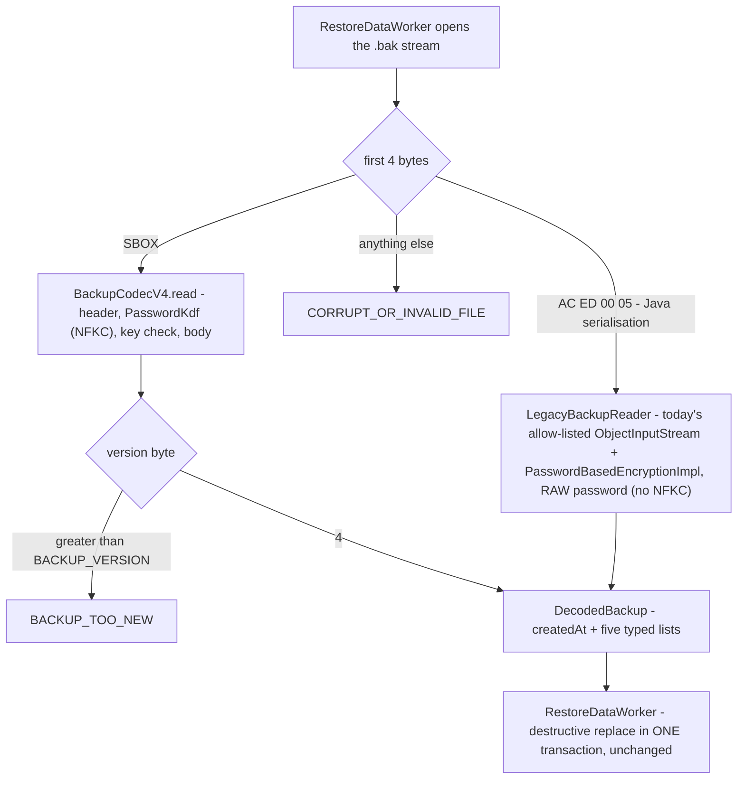

- `RestoreDataWorker` keeps orchestration, the version-too-new check, failure mapping and the DB replace. The v1–v3 code it contains today (map parsing, `SecureObjectInputStream`, creation-date byte quirks, absent-vs-null semantics) moves **verbatim** into `LegacyBackupReader`; behaviour and the `resolveClass` allow-list are unchanged, and it receives the raw, un-normalised password because those files were written without NFKC.
- `BackupDataWorker` only writes v4 through `BackupCodecV4.write`. The `encrypt: Boolean` flag of `PasswordBasedEncryption.encryptDecrypt` goes; `PasswordBasedEncryptionImpl` survives only inside the legacy reader.
- `AEADBadTagException` is a `BadPaddingException`, so the existing wrong-password catch keeps working; the v4 path additionally maps a body-tag failure after a successful key check to `CORRUPT_OR_INVALID_FILE`. The pinned salt/IV workaround in `PasswordBasedEncryptionImplTest` (`75a8d18`) is removed.
- Restoring any format into a v2 vault needs no further change: rows go through the secure DAOs, which encrypt under the DEK.

### 5.4 Other Improvements Considered for v4

| Candidate | Decision | Why |
|---|---|---|
| One encrypted payload instead of five separately encrypted sections | **Yes** | one IV, one tag; no section swapping; absent-vs-null trap gone; files are KB–low MB, no streaming needed |
| Drop Java serialisation from the container | **Yes, for v4** | removes `ObjectInputStream` from the write path and the new read path; the allow-listed legacy reader stays until v1–v3 support is dropped |
| Magic bytes + plaintext JSON header | **Yes** | unambiguous routing; `--header` without a password; additive fields without a version bump |
| Key-check value | **Yes** | wrong password vs damaged file at zero security cost (PBKDF2 dominates each guess) |
| `appVersionCode` in the header | **Yes** | which build wrote the file — the first question in any restore bug |
| Record counts / types in the plaintext header | **No** | metadata leak to anyone holding the file; available after decryption |
| Device model / user id in the header | **No** | fingerprinting, no restore value |
| Compression before encryption | **No, not in v4** | KB–low MB files; another code path and test surface; a future version can add it |
| Backup-password hint stored in the file | **No** | a plaintext hint in a file that travels weakens the password that protects it |
| New extension / MIME type | **No** | `.bak` and the existing MIME filters work; a change breaks the folder-picker flow and the harness |
| Argon2id | **No** | native dependency; out of scope (#242) |
| Per-record encryption inside the payload | **No** | no benefit once the payload is one AEAD blob |

---

# Part II — User Flows & UI

## 6. User & System Flows

Legend: `App` = ViewModel + repository; `KS` = AndroidKeyStore (secure hardware); `DB` = Room; `BP` = `BiometricPrompt` system UI.

| Trigger | Flow |
|---|---|
| App launch — which screen opens | §6.1 |
| Sign up | §6.2 |
| Log in with the master password (v2 vault) + iteration drift | §6.3 |
| First log-in after the update (legacy vault), forgot-password while legacy, **what happens when it fails** | §6.4, §6.4.1, **§6.4.2** |
| Any successful unlock — silent wrap creation (`runAfterUnlock`) | §6.5 |
| Log in with a fingerprint, incl. invalidated key | §6.6 |
| Forgot password (v2 vault), incl. recovery-not-set-up | §6.7 |
| Change the master password in Settings | §6.8 |
| Lock, away-timeout, process death, navigation bypass — and what a bypass obtains | §6.9 |
| Fingerprint added or removed, lock screen removed, alias lost | §6.10, §6.14 |
| Erase everything and start over | §6.11 |
| Fingerprint-unlock switch in Settings | §6.12 |
| Backup / restore while locked or after process death | §6.13 |
| What exists on disk over time — wrap state machine | §6.14 |
| End-to-end journeys J1–J6 | §6.15 |

### 6.1 App Start — Which Screen Opens (`MainViewModel`, §3.6)

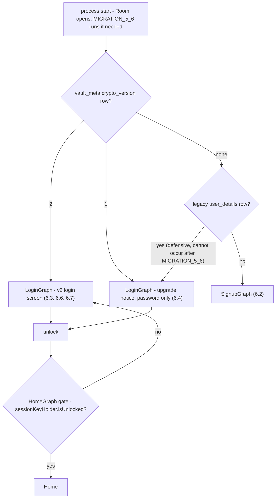

`IS_SIGN_UP_REQUIRED` is still written for compatibility but never decides routing; a vault in Room always wins. The same gate runs when the back stack is restored after process death (§6.9).

### 6.2 Signup

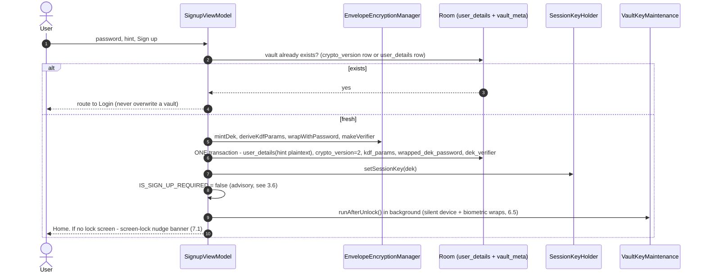

**Why signup checks for an existing vault at all.** For a genuinely new user the check is always "no" and costs one indexed `SELECT`. It exists because signup is the one flow that *destroys* a vault, and the signal that routes to it can lie: `IS_SIGN_UP_REQUIRED` lives in `EncryptedSharedPreferences`, whose own Keystore master key has the same lost-alias failure mode this design removes for records — a lost key reads as "no preferences" ⇒ "sign-up required" ⇒ an existing user lands on the signup screen. Room-first routing (§6.1) already prevents that; the check inside the transaction is the last line of defence against a routing bug or a stale back stack. One query is cheap insurance against overwriting someone's vault.

No prompt at signup. A crash between the transaction and the pref write is harmless: §6.1 routes by Room.

### 6.3 Password Login — Steady State

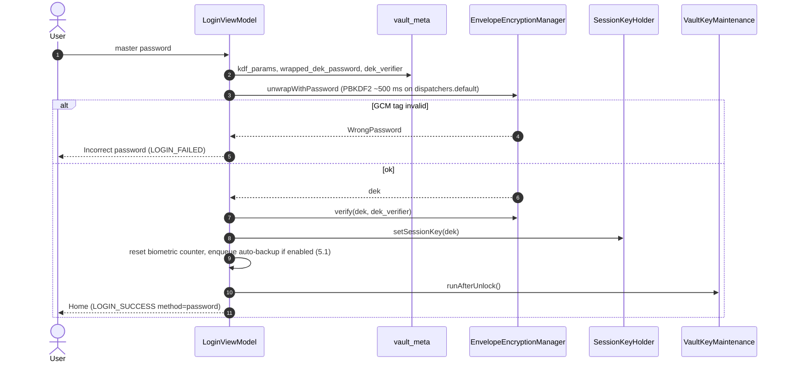

**Iteration drift.** If `kdf_params` carries a count different from the build's `PBKDF2_ITERATIONS`, the login re-wraps `wrapped_dek_password` with the current count while the password is still in hand (one extra derivation, one row update, silent). So the count can be raised — or corrected — in any later release without waiting for a password change.

### 6.4 First Login After the Update — Migration (`crypto_version = 1`)

While `crypto_version = 1` the login screen shows **one inline line** above the password field — *"Security upgrade — enter your master password once"* — and does **not** offer biometric login (no wrap exists yet). Forgot-password while legacy keeps today's gate and then migrates under the new password directly (§6.4.1).

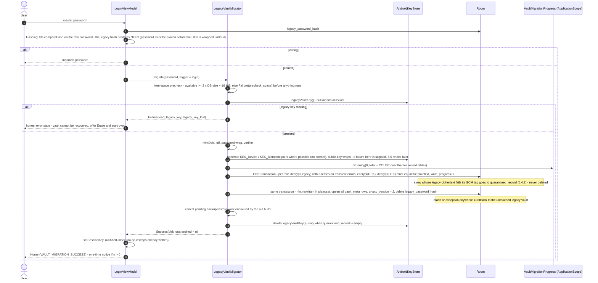

- **UI during the transaction:** non-dismissable **determinate** progress state on the login screen (`progress/total`): every legacy field is a Keystore round-trip of ~2.5 ms on the Pixel 6a, so 100 records take 1.4 s, 500 take 7 s and 2 000 take 27 s before any entry-level derating (ADR-0011 S7). The migrator may run the legacy decrypts on a small worker pool ahead of the single write transaction. The work runs in `@ApplicationScope`; back press and ViewModel clearing cannot abort it.
- **Performance:** every legacy decrypt is a Keystore binder round-trip; after migration every field decrypt is in-process AES-GCM. Measured on the Pixel 6a: reading all fields of 2 000 records takes 24.9 s under the legacy key and 0.63 s under the DEK — the records list gets ~40× faster (ADR-0011 S7).
- **Downgrade after migration:** a v5 build refuses to open a v6 database — a clean failure instead of silent key regeneration. Downgrade stays unsupported.

#### 6.4.1 Forgot Password While Still Legacy (`crypto_version = 1`)
Nothing is tied to a credential yet, so today's reset gate stays valid and `DeviceSecurityRequiredDialog` stays honest **here only**. The legacy hash is **not** rewritten: the new password goes straight into the migration (the migration needs the legacy *key* to read records and the password only to wrap the DEK), so `HashingUtils.hash()` has no caller after MR 5 (D1).

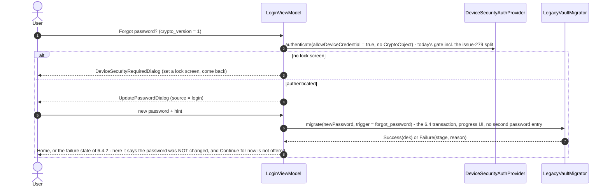

A crash or failure before the transaction commits leaves the vault legacy with the **old** hash; the user repeats this flow (idempotent, one credential prompt). *Continue for now* cannot be offered here because the user does not know the old password.

#### 6.4.2 When the Migration Fails — What the User Keeps and What They Can Do

**The guarantee.** The re-encryption is one Room transaction. Until `COMMIT`, the database holds every record encrypted under the legacy key and `crypto_version` is still `1`. Any failure — an exception, a crash, the process being killed, a reboot, the battery dying — rolls the transaction back and the vault is byte-for-byte what it was before the attempt. The legacy Keystore key is deleted only *after* the commit. There is no state in which some records are under the DEK and others under the legacy key, and no state in which the user's data has been reduced.

**The fallback.** A failed attempt never locks the user out:

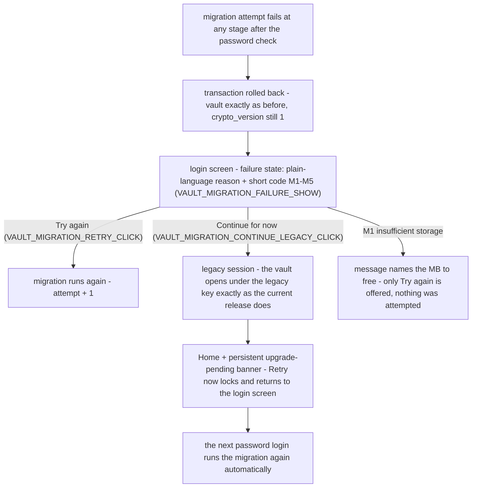

*Continue for now* sets `SessionKeyHolder` to `LegacyUnlocked` with the Keystore handle of the legacy key; the data layer behaves exactly as today (records readable and editable, manual backup possible, auto-backup runs). Biometric login is not offered in a legacy session; the upgrade banner stays on Home. The security level for that user is today's until the migration succeeds — disclosed in §1.4.

**Failure points, one by one.**

| Stage | Failure | Detected how | User sees | Data after it | Code |
|---|---|---|---|---|---|
| precheck | free space < 2 × DB size + 16 MB | `StatFs` on the DB directory | "Not enough storage to upgrade. Free up about *n* MB and try again." | untouched — nothing ran | M1 |
| verify password | wrong password | `compareHash` | "Incorrect password" | untouched | — |
| load legacy key | alias missing (`legacyVaultKey() == null`) | gateway, never regenerates | legacy-key-lost state → Erase & start over (§6.10) | untouched, but was already unreadable | — |
| mint / wrap | KDF or cipher provider exception (not expected on any supported device) | exception | "Upgrade failed (M5). Nothing was changed." + Try again / Continue for now | untouched | M5 |
| optional Keystore wraps | keygen fails (StrongBox, TEE timeout, lock screen removed mid-way) | exception | nothing — step skipped, `VAULT_WRAP_CREATE_FAILURE`, §6.5 retries after unlock | migration continues | — |
| re-encrypt a field | **transient** Keystore error (`KeyStoreException`, `ServiceSpecificException`, `IllegalBlockSizeException` without an AEAD cause) | exception type | retried 3× (100 / 300 / 900 ms); then "The secure hardware did not respond (M2)." + Try again / Continue for now | rollback | M2 |
| re-encrypt a field | `AEADBadTagException` — the row cannot be read under the legacy key (corrupt bytes, or written under an alias that was lost and regenerated years ago). **It is unreadable today too.** | exception type | migration **continues**; after Home a one-time notice: "*n* records could not be read and were set aside" | row preserved in `quarantined_record` (§4.4), removed from the visible table; legacy alias kept | — |
| verify-after-encrypt | `decrypt(DEK, ciphertext) ≠ plaintext` — a bug, never expected | compare | "Upgrade check failed (M3). Nothing was changed." + Try again / Continue for now; non-fatal in Crashlytics with the stage | rollback | M3 |
| commit | `SQLiteFullException` / `SQLiteDiskIOException` / other `SQLiteException` | exception type | M1 message for full disk, otherwise "Could not save the upgrade (M4). Nothing was changed." | rollback | M1 / M4 |
| anywhere | process killed, reboot, battery | — | next launch: the upgrade notice again | rollback by SQLite's journal | — |
| after commit, before legacy-key deletion | crash | — | nothing | v2 vault; alias lingers until `runAfterUnlock` deletes it (§3.5) | — |
| after commit, before `setSessionKey` | crash | — | login screen; next login takes the v2 path | fine | — |

Every row that ends in a user-visible failure also produces the analytics event and the Crashlytics non-fatal of §8.1, with the stage, the reason and the counts — never the content.

**Why quarantine instead of abort or delete.** Aborting on a single unreadable row would leave that user in legacy mode forever (and today such a row already breaks the list it is in, §1.1). Deleting would be irreversible for bytes we cannot read but also cannot prove worthless. Quarantining completes the upgrade for the 99.9 % of rows that are fine, keeps the bytes, keeps the only key that could ever read them, and tells us through `VAULT_MIGRATION_QUARANTINE` how often this happens per table.

**Why verify-after-encrypt.** It makes a committed-but-unreadable migration impossible by construction: each field is decrypted again under the DEK inside the transaction and compared before the row is written. In-process AES-GCM costs microseconds per field.

### 6.5 Post-Unlock Key Maintenance — Silent Wrap Creation
Runs after **every** unlock (password, biometric, recovery), in the background; a no-op in a legacy session.

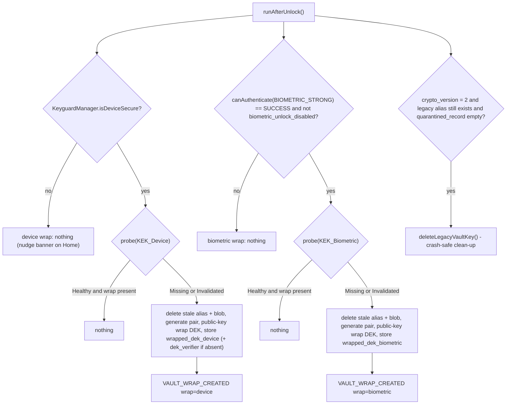

No step prompts. Key generation (RSA-2048 in the TEE, up to seconds on older hardware) runs off the main thread. Failures are logged and retried at the next unlock.

### 6.6 Biometric Login
Pre-conditions evaluated when the login screen opens: `crypto_version = 2`, `wrapped_dek_biometric` present, `canAuthenticate(BIOMETRIC_STRONG) == SUCCESS`, `ALLOWED_BIOMETRIC_LOGIN_COUNT_REMAINING > 0`, and `probe(KEK_Biometric) == Healthy`.

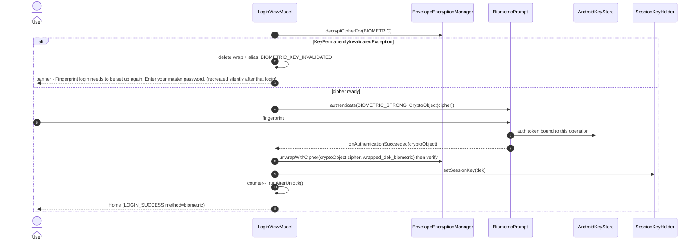

A patched app that calls `doFinal` without the prompt fails: `IllegalBlockSizeException` whose cause is `KeyStoreException: Key user not authenticated` for the per-operation key on API 24–35 (`UserNotAuthenticatedException` is what the *time-bound* key throws at `init`; ADR-0011 S2). Class-2 face unlock is not offered (unchanged from today).

### 6.7 Forgot Password (Login Screen) — Recovery Through `wrapped_dek_device`
Login-screen state when the button is tapped:

| Condition | UI |
|---|---|
| `crypto_version = 1` | today's legacy reset (§6.4.1) |
| `wrapped_dek_device` present and `probe(KEK_Device) ≠ Invalidated` | recovery flow below |
| otherwise | **Recovery-not-set-up** state (§7.1): explanation, link to restore from a manual backup, **Erase everything and start over**. `DeviceSecurityRequiredDialog` is **never** shown here — setting a lock screen now cannot create a wrap. |

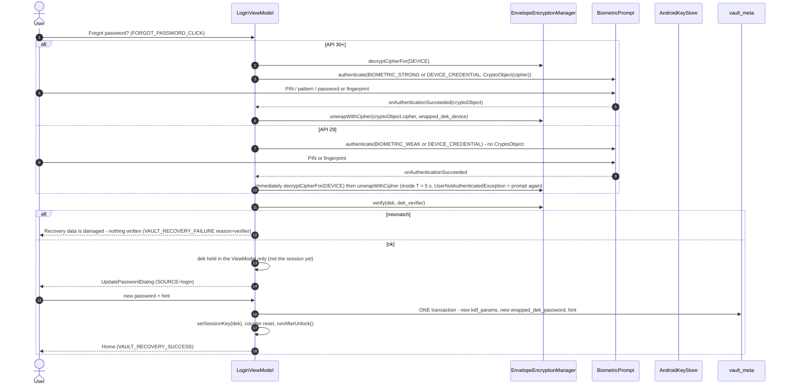

Cancelling the dialog zeroes the held DEK and returns to the login screen. The "password after X biometric logins" counter never blocks this path. Security floor: whoever knows the device PIN can reset the master password — **exactly today's floor**.

### 6.8 Change Master Password (Settings)
Gate: **device authentication first, the current master password as the alternative.** Both prove the same thing — the login-screen recovery already accepts the device credential — so the user gets the easier one.
- `isDeviceSecure` ⇒ `BiometricPrompt` (`BIOMETRIC_STRONG or DEVICE_CREDENTIAL`, no `CryptoObject`: the DEK is already in RAM, the prompt is only a gate).
- No lock screen, a prompt error, or *Use master password instead* ⇒ a current-password field verified with `unwrapWithPassword` (wrong ⇒ "Incorrect password", stay). `DeviceSecurityRequiredDialog` is no longer needed here.
- Then `UpdatePasswordDialog` (`SOURCE=settings`) → `VaultRepository.rewrapPassword(newPassword, dek)`: fresh salt + current iterations, new `wrapped_dek_password`, plaintext hint — one row update, **no record re-encryption, DEK not rotated**. Biometric and device wraps are untouched.
- In a legacy session (§6.4.2) the entry is disabled with the hint "available after the security upgrade" — there is no DEK to re-wrap and `hash()` is gone.

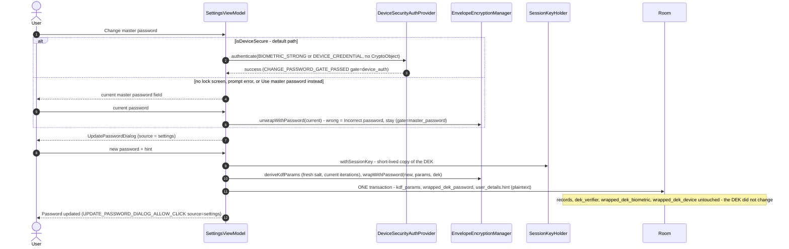

### 6.9 Lock, Timeout, Process Death & Bypass Protection

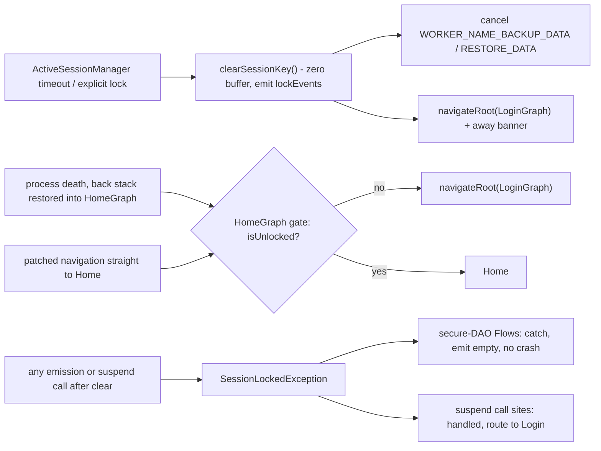

Contract: `SymmetricKeyUtils` fails closed; every secure-DAO `Flow` has `.catch { if (it is SessionLockedException) emit(empty) else throw it }`; `RecordsViewModel`-style `stateIn` pipelines survive a lock without crashing; restore mid-transaction rolls back. Decrypted plaintext already in Compose/ViewModel state is dropped by the navigation, not by key zeroing.

**What a bypass actually obtains:**

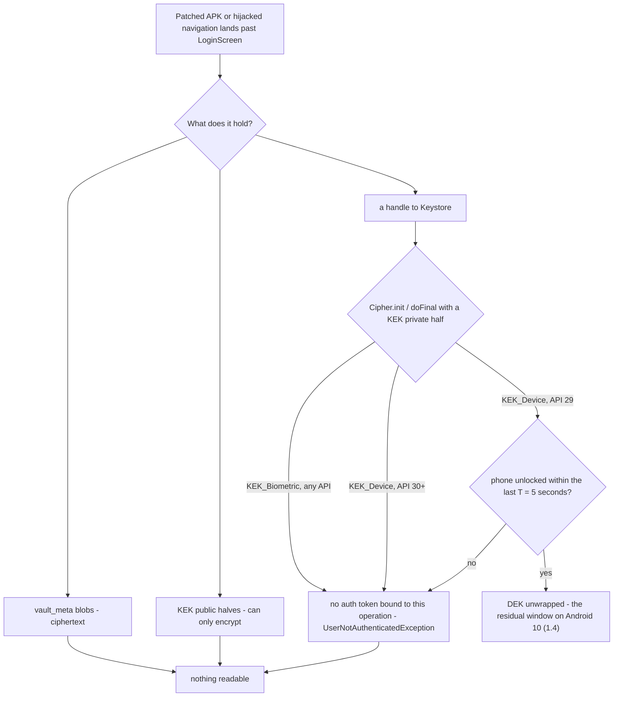

### 6.10 Keystore Self-Healing

| Event | `KEK_Biometric` | `KEK_Device` | App behaviour |
|---|---|---|---|
| New fingerprint enrolled / all removed | invalidated | unaffected | login screen: banner, password login, silent recreation afterwards |
| PIN changed | unaffected | unaffected | nothing |
| Lock screen removed | invalidated | invalidated | both wraps deleted at the next probe; recreated silently once a lock screen exists again |
| Alias missing, `UnrecoverableKeyException`, `KeyStoreException`, StrongBox failure | treated as `Invalidated` | treated as `Invalidated` | same: delete wrap, recreate later. **Never data loss** — the password wrap does not involve Keystore |
| Legacy `symmetricDataKey` missing while `crypto_version = 1` | — | — | **error state, never regenerate** (the vault cannot be migrated); offer Erase & start over |
| App data cleared / reinstall | gone | gone | fresh vault; nothing to recover, as today |

### 6.11 Erase Everything and Start Over
`VaultResetUseCase`. Reachable from the recovery-not-set-up state and from the legacy-key-lost error state only. Manual `.bak` files on external storage are untouched — the user can restore one after signing up again, with that backup's own password.

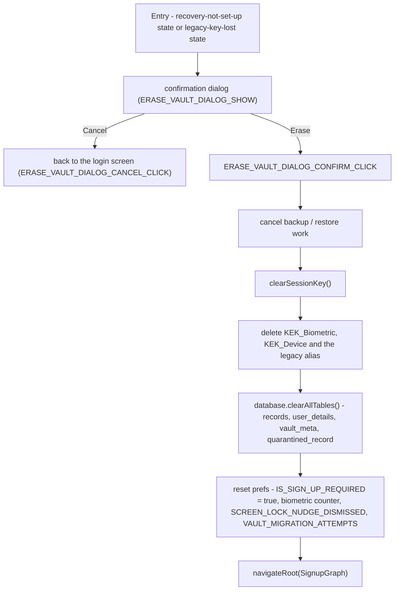

### 6.12 Fingerprint-Unlock Switch (Settings)

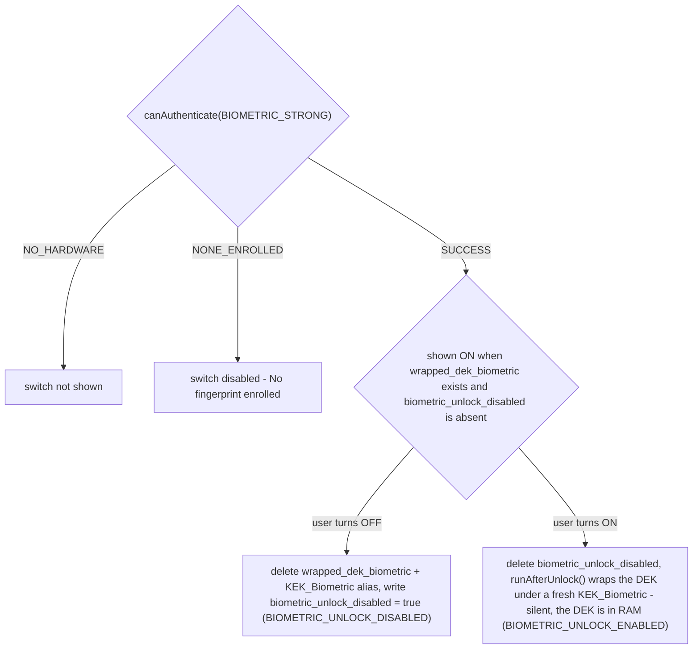

No prompt in either direction (public-key wrap). While OFF, §6.5 skips the biometric branch and the login screen never offers a fingerprint. Hidden in a legacy session.

### 6.13 Backup and Restore Under Lock (§5.1)

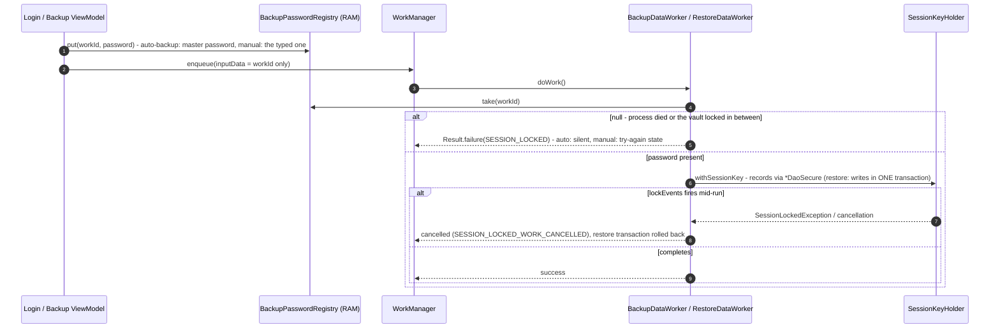

### 6.14 What Is on Disk Over Time

One rule explains everything: **after every unlock, the app silently makes the wraps on disk match what the phone can do right now** (§6.5). The password wrap is always there from signup or migration onwards; the other two come and go with the phone's lock screen and fingerprint.

| What the phone has | Wraps on disk after the next unlock | Fingerprint login | Forgot password |
|---|---|---|---|
| No lock screen | password | no | no — only *Erase everything and start over* |
| PIN / pattern / password, no fingerprint | password + device | no | yes, with the PIN |
| PIN + fingerprint, switch on | password + device + biometric | yes | yes, PIN or fingerprint |
| PIN + fingerprint, switch off (§6.12) | password + device | no | yes |

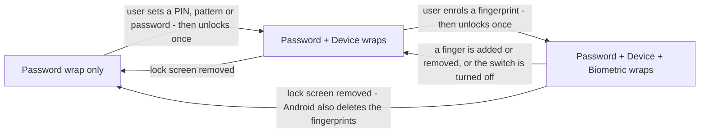

Two consequences worth remembering: a biometric wrap never exists without a device wrap (a fingerprint needs a lock screen, and §6.5 creates both in the same pass); and a wrap can only be *created* while the vault is open, so a user who sets a PIN after forgetting the password gains nothing (J1).

### 6.15 End-to-End User Journeys

#### J1 — Sign up with no lock screen, forget the password later

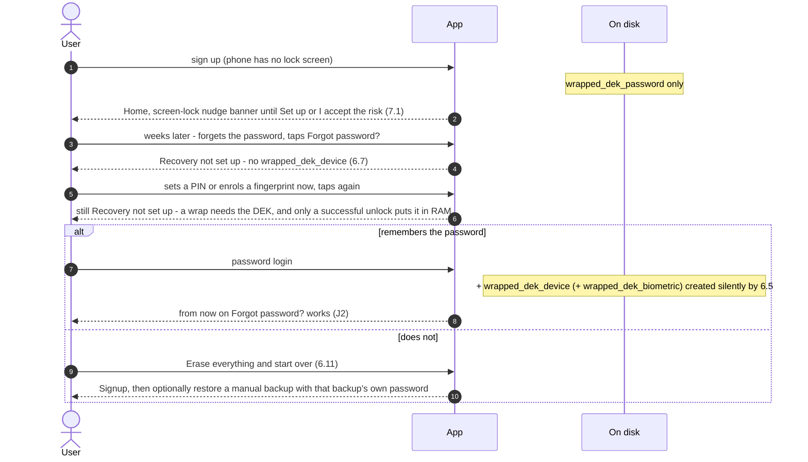

#### J2 — Set a lock screen, then log in with the master password

```mermaid
sequenceDiagram
    autonumber
    actor U as User
    participant Phone as Phone settings
    participant App
    participant KS as AndroidKeyStore
    participant Disk as On disk
    U->>Phone: sets a PIN and enrols a fingerprint
    U->>App: login with the master password (6.3)
    Note over App: DEK in RAM - runAfterUnlock() (6.5)
    App->>KS: generate KEK_Device pair (RSA-2048, auth-bound, no prompt)
    App->>Disk: wrapped_dek_device = OAEP(KEK_Device.pub, DEK)
    App->>KS: generate KEK_Biometric pair (fingerprint enrolled, switch not OFF)
    App->>Disk: wrapped_dek_biometric = OAEP(KEK_Biometric.pub, DEK)
    Note over Disk: password + device + biometric wraps, dek_verifier
    Note over U,Disk: the user saw nothing
    U->>App: next launch - fingerprint login offered (6.6)
    U->>App: months later - Forgot password? - PIN or fingerprint prompt - DEK unwrapped - new password (6.7)
```

#### J3 — A new fingerprint is enrolled

```mermaid
sequenceDiagram
    autonumber
    actor U as User
    participant Phone as Phone settings
    participant App
    participant KS as AndroidKeyStore
    participant Disk as On disk
    U->>Phone: adds a second finger
    Note over KS: KEK_Biometric permanently invalidated by the hardware, KEK_Device untouched
    U->>App: opens the app - login screen
    App->>KS: probe(KEK_Biometric) = Invalidated
    App->>Disk: delete wrapped_dek_biometric (BIOMETRIC_KEY_INVALIDATED)
    App-->>U: banner - Fingerprint login needs to be set up again, enter your master password
    U->>App: password login
    Note over App: runAfterUnlock() - new KEK_Biometric pair, new wrap, silently
    Note over Disk: password + device + biometric wraps again
    Note over U,Disk: Forgot password? kept working the whole time - it uses KEK_Device
```

#### J4 – J7 in brief

| Journey | Step by step | On disk at the end |
|---|---|---|
| **J4 Upgrade from today's build** | install → Room opens, `MIGRATION_5_6` (`crypto_version = 1`, hash parked, `password` column dropped) → login screen shows the one-line upgrade notice, no fingerprint button → password → `compareHash` → one-transaction re-encryption with progress (§6.4) → Home → §6.5 creates the wraps the device allows → next launch: fingerprint login is back | `crypto_version = 2`, password wrap (+ device, + biometric), verifier; legacy alias and hash gone |
| **J5 Away-timeout while an auto-backup runs** | timeout → `clearSessionKey()` → `lockEvents` → backup cancelled (`SESSION_LOCKED_WORK_CANCELLED`) → `navigateRoot(LoginGraph)` + away banner → password login → auto-backup enqueued again (§6.3) | unchanged |
| **J6 Lock screen removed, later set again** | remove lock screen (Android also deletes the fingerprints) → both Keystore keys invalidated → next launch: no fingerprint button, password login → probes delete both wraps, Home nudge shown → user sets a PIN (+ fingerprint) → next unlock → wraps recreated silently | password wrap only, then all three again |
| **J7 Upgrade on a full phone** | install → upgrade notice → password → precheck fails: "Free up about 40 MB" (M1) → user deletes photos → Try again → migration runs → Home. Or: user taps *Continue for now* → legacy session, upgrade-pending banner → next login retries automatically | legacy until the retry succeeds, then as J4 |

---

## 7. UI & Screen Changes

### 7.1 New / Changed Components

| Component | Where | Behaviour |
|---|---|---|
| Migration banner + progress state | `LoginScreen` | inline text while `crypto_version = 1`; non-dismissable progress during §6.4 |
| **Migration failure state** | `LoginScreen` | plain-language reason + code M1–M5, *Try again*, *Continue for now* (hidden for M1 and in the forgot-password variant), §6.4.2 |
| **Upgrade-pending banner** | `HomeScreen` | shown throughout a legacy session: "Security upgrade pending — it runs at your next sign-in" + *Retry now* (locks, returns to login) |
| **Quarantine notice** | `HomeScreen`, once after a migration with `quarantined > 0` | "*n* records could not be read and were set aside. They were unreadable before the upgrade as well." + *OK*; analytics triad |
| Away banner | `LoginScreen` | replaces `UserAwayDialog` (route and composable removed; three androidTests updated) |
| Biometric-invalidated banner | `LoginScreen` | *"Fingerprint login needs to be set up again — enter your master password"* |
| **Recovery-not-set-up state** | `LoginScreen` ← Forgot password | explanation, restore-from-manual-backup link, Erase & start over |
| **Erase everything and start over** dialog | `ui/core/vault/` | §6.11, own analytics triad |
| **Screen-lock nudge** banner | `HomeScreen` | shown while `!isDeviceSecure` and `SCREEN_LOCK_NUDGE_DISMISSED` is unset: *"Set a screen lock so a forgotten master password can be recovered"* — *Set up* → `Settings.ACTION_SECURITY_SETTINGS`; *I accept the risk* → `SCREEN_LOCK_NUDGE_DISMISSED = true` in `SettingsDataStore`, never shown again; the flag is cleared by Erase & start over |
| **Fingerprint unlock switch** | `SettingsScreen` | off: delete `wrapped_dek_biometric` + alias, `biometric_unlock_disabled = true`; on: clear flag, `runAfterUnlock()` creates the wrap silently; hidden in a legacy session |
| **Change-password gate** | `SettingsScreen` → `UpdatePasswordDialog` | device authentication when `isDeviceSecure`; otherwise, on prompt error, or via *Use master password instead*: a current-password field verified with `unwrapWithPassword` (§6.8); disabled in a legacy session |
| Restore failure copy | `BackupAndRestoreScreen` | v4 distinguishes "Incorrect password" from "This file is damaged or not a Safe-Box backup" (§5.2) |
| `DeviceSecurityAuthProvider` | `ui/core` | `CryptoObject` in/out (§3.7) |
| `DeviceSecurityRequiredDialog` | — | **removed from the login screen** (v2 vaults) and from Settings; kept only for the legacy reset (§6.4.1) |
| Signup / change-password copy | strings | hint-is-not-secret; recovery depends on a screen lock |

Resource names already used by the upgrade harness (`UnlockScreen` labels) are **not renamed** (ADR-0003). New strings go through the localization skill (26 locales) in the MR that adds them.

---

## 8. Analytics & Diagnostics

### 8.1 Migration Diagnostics — Seeing a Failure in Firebase Without Seeing the User's Data

Three channels, all fed by `LegacyVaultMigrator` through `AnalyticsHelper` and the `CrashReporter` seam (§3.8), all asserted in `LegacyVaultMigratorTest`:

1. **Analytics event with structured params** — the aggregate view: how many, on which API levels, at which stage, for which reason.
2. **Crashlytics non-fatal** (`Timber.e(VaultMigrationException)` → `ReleaseTree.recordException`) — the individual view: the real stack trace of the underlying exception, the custom keys below, and the breadcrumbs that preceded it.
3. **Breadcrumbs** (`Timber.i`, forwarded to `crashlytics.log` by `ReleaseTree`) — at stage boundaries and once per table, never per row: `migration: stage=reencrypt table=login_data rows=120`.

| Event | Params (all non-PII) | Fired |
|---|---|---|
| `VAULT_MIGRATION_START` | `trigger = login \| forgot_password`, `record_count`, `db_size_kb`, `free_space_mb`, `attempt` | once per attempt, after the password check |
| `VAULT_MIGRATION_SUCCESS` | `duration_ms`, `record_count`, `records_quarantined`, `retries` (field-level retries that succeeded), `legacy_decrypt_ms`, `wraps = none \| device \| device_biometric`, `attempt` | commit done |
| `VAULT_MIGRATION_FAILURE` | `stage = precheck_space \| load_legacy_key \| mint_dek \| wrap_password \| reencrypt \| verify_reencrypt \| commit \| delete_legacy_key`, `reason = insufficient_space \| legacy_key_lost \| keystore_transient \| sqlite_full \| sqlite_io \| sqlite_other \| verify_mismatch \| cancelled \| unknown`, `exception` (class simple name of the root cause, no message), `table = login_data \| … \| hint \| none`, `records_done`, `record_count`, `retries`, `duration_ms`, `free_space_mb`, `attempt`, `code = M1…M5` | once per failed attempt |
| `VAULT_MIGRATION_QUARANTINE` | `table`, `count`, `reason = aead_bad_tag \| malformed_ciphertext` | once per table with quarantined rows, inside a successful attempt |
| `VAULT_MIGRATION_FAILURE_SHOW` / `VAULT_MIGRATION_RETRY_CLICK` / `VAULT_MIGRATION_CONTINUE_LEGACY_CLICK` | `code` | the failure state (§6.4.2) |
| `VAULT_QUARANTINE_NOTICE_SHOW` / `_OK_CLICK` | `count` | the one-time notice |
| `VAULT_LEGACY_SESSION_START` | `attempt` | each legacy-session login, so the stuck population is measurable |

The Android version is **not** a param: GA attaches *OS version* to every event as a standard dimension, so `api_level` would be a duplicate that costs a custom-definition slot.

Crashlytics custom keys set *before* `recordNonFatal`: `migration_stage`, `migration_reason`, `migration_table`, `migration_records_done`, `migration_record_count`, `migration_attempt`, `migration_free_space_mb`. `VaultMigrationException.message` is exactly `"stage=…, reason=…, table=…, done=…/…"`, and it wraps the real cause so the stack trace points at the failing Keystore or SQLite call.

Rules:
- **Never logged:** record contents, titles, hints, passwords, salts, DEK or wrap bytes, row keys, file paths with user names, exception *messages* (an `SQLiteException` message can quote a statement). The `exception` param is the class name only.
- Firebase limits respected: ≤ 25 params per event, names ≤ 40 characters, string values ≤ 100 characters.
- **Registration (AGENTS.md Param Registration Rule).** GA drops an unregistered param from every report with no backfill, so every new param below is registered as a custom definition *before* the build reaches a testing track, named in the PR description, and added to the register in [`docs/analytics/firebase-setup.md#custom-definitions`](../analytics/firebase-setup.md#custom-definitions). Already added by MR T (pending registration): dimensions `device_secure`, `biometric_class`, `strongbox`, `exception`, `db_exists`, `worker_running`; metrics `duration_ms`, `record_count`, `free_space_mb`, `db_size_kb`, `size_kb`. Still to come with MR 1–9 — dimensions (exact values, low cardinality): `stage`, `table`, `code`, `trigger`, `attempt`, `wraps`, `gate`, `worker`, `wrap`; metrics (sums and averages are meaningful): `records_done`, `records_quarantined`, `retries`, `legacy_decrypt_ms`. `reason`, `source`, `version`, `count`, `login_method` already exist. Quota after MR T: 20 / 50 dimensions and 6 / 50 metrics; after MR 1–9 about 29 / 50 and 10 / 50. Until registered, values are still visible in Realtime, logcat (`FA-SVC`) and BigQuery (60-day sandbox window).
- `attempt` lives in `SettingsDataStore` (`VAULT_MIGRATION_ATTEMPTS`), incremented at `START`, reset at `SUCCESS` and by Erase.
- Debug builds additionally log per-row progress at `Timber.d` (DebugTree only — the release tree drops DEBUG).

### 8.2 Event Table

Entries in `enum class AnalyticsKey(val eventName: String)`, loggers in `AnalyticsHelper`, asserted in the owning ViewModel tests. `AnalyticsParam` today has `SOURCE`, `REASON`, `VERSION`, `COUNT`, `LOGIN_METHOD`, `LOGIN_COUNT`, `RECORD_TYPE`, `FIELD`, `HAD_INPUT`, `RESULT`, `MESSAGE`, `IS_ENABLED`; MR T adds the telemetry params (§9.0) and MR 1–9 add `WRAP`, `WRAPS`, `STAGE`, `TABLE`, `EXCEPTION`, `CODE`, `TRIGGER`, `GATE`, `WORKER`, `DURATION_MS`, `RECORD_COUNT`, `RECORDS_DONE`, `RECORDS_QUARANTINED`, `RETRIES`, `ATTEMPT`, `FREE_SPACE_MB`, `DB_SIZE_KB`, `LEGACY_DECRYPT_MS`. All names ≤ 40 chars; wire values append-only.

| Event | Params | Fired from |
|---|---|---|
| existing `LOGIN_SUCCESS` (#294) | existing `login_method` gains the value **`legacy_session`** (`LoginMethod` is append-only; `password_reset` already covers recovery logins), existing `login_count`; **+ `device_secure`, `biometric_class`** from MR T | `LoginViewModel.onAuthSuccess` |
| `VAULT_MIGRATION_*` (seven events) | §8.1 | `LegacyVaultMigrator`, `LoginViewModel` |
| `VAULT_QUARANTINE_NOTICE_SHOW` / `_OK_CLICK`, `VAULT_LEGACY_SESSION_START` | §8.1 | `HomeViewModel`, `LoginViewModel` |
| `VAULT_WRAP_CREATED` / `VAULT_WRAP_CREATE_FAILURE` | `wrap = biometric \| device`, `reason`, `exception` | §6.5 |
| `BIOMETRIC_KEY_INVALIDATED` / `DEVICE_KEY_INVALIDATED` | — | probes |
| `FORGOT_PASSWORD_CLICK` | — | login screen |
| `RECOVERY_NOT_SET_UP_SHOW` | — | §6.7 |
| `VAULT_RECOVERY_SUCCESS` / `VAULT_RECOVERY_FAILURE` | `reason = not_authenticated \| verifier \| keystore`, `exception` | §6.7 |
| `ERASE_VAULT_DIALOG_SHOW` / `_CONFIRM_CLICK` / `_CANCEL_CLICK` | — | §6.11 |
| `SCREEN_LOCK_NUDGE_SHOW` / `_OPEN_SETTINGS_CLICK` / `_ACCEPT_RISK_CLICK` | — | Home banner |
| `BIOMETRIC_UNLOCK_DISABLED` / `BIOMETRIC_UNLOCK_ENABLED` | — | Settings switch |
| `SESSION_LOCKED_TIMEOUT` | — | one event per timeout |
| `SESSION_LOCKED_WORK_CANCELLED` | `worker` | §5.1 |
| `CHANGE_PASSWORD_GATE_PASSED` | `gate = device_auth \| master_password` | §6.8 |
| existing `UPDATE_PASSWORD_DIALOG_SHOW / ALLOW_CLICK / CANCEL_CLICK` | **+ `source = login \| settings`** | both dialogs |
| existing `DEVICE_SECURITY_REQUIRED_DIALOG_SHOW` | **+ `source`** | legacy reset only (§6.4.1) |
| existing `BACKUP_DATA_SUCCESS` / `RESTORE_DATA_SUCCESS` | **+ `version`, `duration_ms`** | MR 8 (#242). `version ≤ 3` on restore decides when the legacy reader can go |
| existing `RESTORE_DATA_WRONG_PASSWORD` / `RESTORE_DATA_FAILURE` | `version` (exists) **+ `reason = key_check \| body_tag \| container`** | v4 distinguishes wrong password (key check) from damage (body tag) |

**Pre-release baseline:** `DEVICE_SECURITY_REQUIRED_DIALOG_SHOW` on API ≠ 28/29 approximates how many users reach the reset button with no lock screen today — the population v2 cannot recover.

---

# Part III — Implementation Plan & Verification

## 9. Implementation Plan (Feature Branch & Child MRs)

### 9.0 Before MR 1 — the Telemetry Patch (MR T → `master`, released as the next tag)

Several parts of this plan exist for corner cases nobody has measured. A logging-only patch, shipped to users now, answers them with production data by the time MR 4–5 are planned — and can delete components before they are built. **Zero behaviour change**: every addition is an event, a param, or a `catch` that logs and rethrows.

| Question | Event / param (new in **bold**) | Fired from | Decision it settles — and what it can delete |
|---|---|---|---|
| How many active users have **no lock screen**, and which biometric class do they have? Does **StrongBox** matter? | existing `login_success` + **`device_secure`** (`0/1`), **`biometric_class`** (`strong` / `weak_only` / `none_enrolled` / `no_hardware` / `unavailable`), **`strongbox`** (`0/1`) | `LoginViewModel.onAuthSuccess`, via `DeviceSecurityStatus.snapshot()` (`KeyguardManager.isDeviceSecure`, `BiometricManager.canAuthenticate` strong then weak, `FEATURE_STRONGBOX_KEYSTORE`), behind `runCatching` | the size of the population that forgot-password cannot recover (§1.4.2); whether the nudge and *I accept the risk* persistence (§7.1) deserve their own UI or a single line; `strongbox` share decides whether S5's StrongBox timing matters |
| Are there **rows today's key cannot decrypt** — the silent breakage of §1.1? | **`record_decrypt_failure`** with **`exception`** (simple class name only); once per exception class per process; the decorator around `SymmetricKeyUtilsImpl` logs, records a Crashlytics non-fatal (its stack names the DAO, so the table needs no param), and **rethrows the same instance** | `DecryptFailureReportingSymmetricKeyUtils.decrypt`, wrapped in by `SecurityModule.provideSymmetricKeyUtils` | **zero over six weeks ⇒ drop `quarantined_record`, the notice and decision 7** (≈ 6 files + UI); the migration then fails closed on such a row |
| Does the **Keystore alias disappear** in the field — the silent data-loss path? | **`keystore_key_created`** with **`db_exists`** (`0/1`): `1` means a vault file already existed when the key had to be generated — the loss signature, read directly, no join on earlier `login_success` needed | `SecurityModule.provideSymmetricKey`, exactly where `containsAlias` is false today | the real frequency of objective 4's failure mode; nothing to delete, a number to quote |
| **How big are vaults, how full are phones?** | **`vault_stats`**, once per unlock session: **`record_count`**, **`db_size_kb`**, **`free_space_mb`** (metrics; the two sizes are `-1` when the storage read fails) | `RecordsViewModel`, an `onEach` inside the shared record pipeline (there is no `HomeViewModel`), storage read on `dispatchersProvider.io` through `VaultStorageStats` | P95 `record_count` < 200 ⇒ **indeterminate progress only, S7 shrinks**; nobody under 100 MB free ⇒ the precheck stays (ten lines) but **the M1 copy and J7 go** |
| How often is **forgot-password used, and on which Android versions**? | **`forgot_password_click`**; existing `device_security_required_dialog_*` and `update_password_dialog_*` + existing `source` (`login` / `settings`); GA's standard *OS version* dimension gives the API split | `LoginViewModel` (new `LoginScreenAction.ForgotPasswordClicked`, sent before the device-security check), `SettingsViewModel` | API 29 recovery usage ≈ 0 ⇒ **drop the time-bound `KEK_Device` path: recovery becomes API 30+ (Android 10 maps to the recovery-not-set-up state), `T`, S1, the §1.3 residual and decision 3 disappear** |
| Which **backup formats** circulate; how long do backup and restore take? | existing `backup_data_success` + existing `version`, **`duration_ms`**, **`size_kb`** (`-1` when the document provider cannot report a length); existing `restore_data_success` + `version`, **`duration_ms`** | both workers | sizes the v4 PBKDF2 budget on restore; sets the horizon for dropping the legacy reader (D10) |
| How often does the **away-timeout** fire, and does it ever hit a running backup? | **`session_timeout`** with **`worker_running`** (`0/1`), read from `getWorkInfosForUniqueWorkFlow` for both worker names after the logout event is emitted; a WorkManager failure logs `0` | `ActiveSessionManager` | never during a backup ⇒ cancel-on-lock stays, but the manual dialog's `SESSION_LOCKED` state can be a toast rather than a state |

Rules for MR T: all new params are registered in GA **before** the build reaches a testing track and added to the register in [`firebase-setup.md`](../analytics/firebase-setup.md) (six dimensions: `device_secure`, `biometric_class`, `strongbox`, `exception`, `db_exists`, `worker_running`; five metrics: `record_count`, `db_size_kb`, `free_space_mb`, `duration_ms`, `size_kb` — quota after: 20 / 50 and 6 / 50); every event is asserted in the owning unit test; `record_decrypt_failure` and `keystore_key_created` never carry content. The page [`docs/analytics/envelope-readiness.md`](../analytics/envelope-readiness.md) holds one BigQuery recipe per row above so the read-back is a copy-paste, not a research task. **Read-back deadline:** the BigQuery dataset is in the sandbox — tables expire 60 days after creation — so the queries run (and their results go into the ADR) between week 4 and week 8 after the patch ships, before MR 5 is planned.

### 9.1 Delivery Model & Rules
All code lands on **`feature/envelope-encryption`** through small, reviewable child MRs; the branch merges into `master` once, followed by **one release** (third version component becomes `6`).

1. **Incomplete is fine, red is not.** A child MR may leave the app functionally unfinished (e.g., a login path not wired yet), but it compiles and `testDebugUnitTest` + `lintRelease` pass — so review bots and CI report only on what the MR changed.
2. **≤ 100 files per MR**, split by review topic rather than standalone shippability. Estimates below count production + test files.
3. **Bridge code carries a plain TODO.** Anything that exists only to connect MRs — an unused class or Hilt binding, a stub, a branch that cannot be reached yet — gets `// TODO(MR<n>): <what completes it>` naming the MR that removes it, e.g. `// TODO(MR5): wired into LoginViewModel`. No special tags, no suppressions. Each MR description lists the TODOs it adds and removes; the final PR to `master` requires `git grep -nE "TODO\((MR|TEMP|review)"` to be empty (debt row D9, working rule §15.1).
4. **Two things go to `master` directly, everything else to the feature branch:** MR 0 (docs + spike ADR) and MR T (the telemetry patch, §9.0). Only `master` reaches users, and the design should be findable from day one rather than live inside a long-lived branch; later edits to the design doc ride inside the child MR that changes the plan, and the feature branch's copy overwrites `master`'s at the final merge. The `minSdk` 29 bump ([ADR-0012](../decisions/0012-min-sdk-29.md)) is deliberately *not* a third exception: it rides the feature branch so that any interim `master` release still reaches Android 7–9 users.
5. **Issue references.** A child MR that implements a tracked issue says *Part of #n* in its description (MR 8 → *Part of #242*). `Closes #n` belongs **only** on the final PR into `master` (GitHub only auto-closes on merges into the default branch).
6. **Upgrade harness (`run-upgrade-test` label)** runs on the final PR to `master`: N-1 → envelope build (journey J4). N-1 is whatever `scripts/lib/previous-release.sh` resolves at the time — `v2.1.4.0` today, `v2.2.5.x` once the current release candidate ships. Child MRs rely on `MigrationTest` and unit tests.
7. **Analytics, ViewModel tests, strings (localization skill) and knowledge-base updates** ship inside the MR that introduces the behaviour.

### 9.2 MR Dependency Graph & Summary

```mermaid
graph LR
    MRT["MR T telemetry patch (into master, released)"] -.->|"6 weeks of data"| MR5
    MR0["MR 0 docs + spike results (into master)"] --> MS["minSdk 29 (first child MR, feature branch)"]
    MS --> MR1["MR 1 crypto core"]
    MR1 --> MR2["MR 2 schema v6"]
    MR2 --> MR3["MR 3 holder-backed data layer, fail closed"]
    MR3 --> MR4["MR 4 session lifecycle, workers"]
    MR4 --> MR5["MR 5 signup, password login, migration + fallback"]
    MR5 --> MR6["MR 6 biometric login, recovery, erase"]
    MR6 --> MR7["MR 7 Settings + Home"]
    MR7 --> MR8["MR 8 backup format v4 (issue 242)"]
    MR8 --> MR9["MR 9 instrumentation, cleanup, docs"]
    MR9 --> M["feature branch into master, one release"]
```

| MR | Target | Scope | ≈ files | `TODO(MR n)` |
|---|---|---|---|---|
| **T** | `master`, released | Telemetry patch (§9.0): 5 new events, 11 new params, `DeviceSecurityStatus` + `VaultStorageStats`, decrypt-failure decorator around `SymmetricKeyUtilsImpl`, `docs/analytics/envelope-readiness.md`, register update, unit tests. **Merged 2026-10-21 (#298)** | 31 | — |
| **0** | `master` | `docs/design/envelope-encryption.md`, ADR with spike results S1–S11, `docs/README.md` link, `/scratch/` in `.gitignore` | 4–6 | — |
| **1** | `feature/*` | Crypto core (`security/envelope/`): `SessionKeyHolder` (incl. legacy state), `PasswordKdf` + `KdfParams`, `AesGcmWrap`, `DekVerifier`, `KeystoreGateway` + `AndroidKeystoreGateway` + `FakeKeystoreGateway`, `EnvelopeEncryptionManager`, `CrashReporter` + fake, Hilt bindings, JVM tests | ≈ 24 | adds `MR5` on unused bindings |
| **2** | `feature/*` | Room schema v6: `vault_meta` + `quarantined_record` entities and DAOs, `MIGRATION_5_6`, `6.json`, `MigrationTest`; `UserDetailsEntity` without `password`; legacy check/reset read `vault_meta.legacy_password_hash`; hint read path branching on `crypto_version` | ≈ 20 | — |
| **3** | `feature/*` | Holder-backed data layer: `SymmetricKeyUtils` takes its key from `SessionKeyHolder` (DEK or legacy handle); `SecurityModule` drops the ambient key and never regenerates; six `*DaoSecure` `.catch` on `SessionLockedException`; suspend-site handling + tests | ≈ 28 | adds `MR5` (holder not populated yet) |
| **4** | `feature/*` | Session lifecycle & workers: `ActiveSessionManager` → `clearSessionKey()`; timeout ⇒ `LoginGraph` + away banner; remove `UserAwayDialog` + route + 3 androidTests; `HomeGraph` gate; Room-first start routing; `BackupPasswordRegistry`, cancel-on-lock, `SESSION_LOCKED` + `*FailureReasonTest`; analytics | ≈ 35 | — |
| **5** | `feature/*` | Vault flows part 1: `VaultRepository`, `LegacyVaultMigrator` (precheck, retries, quarantine, verify-after-encrypt, diagnostics), `VaultKeyMaintenance`, `VaultMigrationProgress`; `SignupViewModel`; `LoginViewModel` password login + drift re-wrap, migration + progress UI, **failure state + Continue for now**, legacy forgot-password; Home upgrade-pending banner + quarantine notice; strings, analytics, VM tests | ≈ 36 | removes `MR5`; adds `MR6` on biometric branch |
| **6** | `feature/*` | Vault flows part 2: biometric login with `CryptoObject` + invalidation banner; forgot-password recovery (API 30+ / 29); recovery-not-set-up state; `VaultResetUseCase` + erase dialog; `DeviceSecurityRequiredDialog` off the v2 login; analytics, VM tests | ≈ 28 | removes `MR6` |
| **7** | `feature/*` | Settings & Home: change-password gate + re-wrap, fingerprint-unlock switch, legacy-session disabling; Home screen-lock nudge; strings, analytics, VM tests | ≈ 20 | — |
| **8** | `feature/*` | Backup format v4 (*Part of #242*): `BackupCodecV4`, `LegacyBackupReader` (code moved out of `RestoreDataWorker`), `DecodedBackup`, worker routing, `InspectBackup.java` v4 branch, `update-seed.sh` run (v3 → `format-3.bak`, new v4 seed), `backup-format.lock`, tests, analytics | ≈ 18 | — |
| **9** | `feature/*` | Instrumentation & final cleanup: `KeystoreWrapKeysTest`, `VaultCryptoMigrationTest`, `BypassProtectionTest`, timeout test; delete `HashingUtilsImpl.hash()` + D-register items; `TODO(MR` sweep; `persistence-and-crypto.md`, `PROJECT_FACTS.md`, testing docs, ADR | ≈ 30 | removes all |

### 9.3 Detailed MR-by-MR Walkthrough

#### MR T — Telemetry Patch (`→ master`, released as the next tag) — **merged 2026-10-21 as #298 (`80a5900`), 31 files**
- `AnalyticsKey`: `RECORD_DECRYPT_FAILURE`, `KEYSTORE_KEY_CREATED`, `VAULT_STATS`, `FORGOT_PASSWORD_CLICK`, `SESSION_TIMEOUT` (+ `version`/`duration_ms`/`size_kb` on `backup_data_success`, `version`/`duration_ms` on `restore_data_success`). `AnalyticsParam`: `DEVICE_SECURE`, `BIOMETRIC_CLASS`, `STRONGBOX`, `EXCEPTION`, `DB_EXISTS`, `RECORD_COUNT`, `DB_SIZE_KB`, `FREE_SPACE_MB`, `DURATION_MS`, `SIZE_KB`, `WORKER_RUNNING`. `AnalyticsSource`: `LOGIN`, `SETTINGS`. `LoginMethod` untouched (its wire values are append-only; `legacy_session` is added in MR 5).
- `DeviceSecurityStatus` (`security/interfaces/`, `snapshot(): DeviceSecuritySnapshot(isDeviceSecure, biometricClass, hasStrongBox)`) + `AndroidDeviceSecurityStatus` with a pure `classifyBiometric(strong, weak)`; `VaultStorageStats` (`common/`, `snapshot(): VaultStorageSnapshot(dbSizeKb, freeSpaceMb)`, `-1` on a failed read) + `AndroidVaultStorageStats`. Both bound in a new `di/TelemetryModule` rather than `DeviceSecurityModule`, which androidTest replaces. Reused unchanged by `VaultKeyMaintenance` in MR 5.
- `SymmetricKeyUtilsImpl` is **not edited**: `SecurityModule.provideSymmetricKeyUtils` wraps it in `DecryptFailureReportingSymmetricKeyUtils`, a decorator whose `decrypt` catches, logs `record_decrypt_failure` with `exception` (once per exception class per process, plus a `Timber.e` non-fatal carrying the stack, which names the DAO and so the table), and rethrows the same instance. `provideSymmetricKey` logs `keystore_key_created` with `db_exists = context.getDatabasePath(DATABASE_NAME).exists()` at the existing `containsAlias == false` branch — the join on earlier `login_success` events is no longer needed to tell a first launch from a loss. `ActiveSessionManager`: `session_timeout` with `worker_running` from `getWorkInfosForUniqueWorkFlow(...).first()` for both worker names, after the logout event is emitted; a read failure logs `0`. `RecordsViewModel` (there is no `HomeViewModel` today): `vault_stats` as an `onEach` inside the shared record pipeline, so it fires once per ViewModel and never without a collector. `LoginViewModel`: `forgot_password_click` via a new `LoginScreenAction.ForgotPasswordClicked` sent first from `onForgotPasswordClick`; `device_secure` / `biometric_class` / `strongbox` on `login_success` behind `runCatching`; `source = login` on all seven dialog events. `SettingsViewModel`: `source = settings` on the same seven.
- `docs/analytics/firebase-setup.md`: `version` and `source` rows extended; a *Pending* block with the eleven new params (6 dimensions, 5 metrics; quota after 20 / 50 and 6 / 50) to fold into the dated table once registered. `docs/analytics/envelope-readiness.md`: events, questions, seven BigQuery recipes, read-back deadline; linked from `docs/README.md`. `PROJECT_FACTS.md`: the silent-regeneration fact now points at its detector; the GA-registration trap was evicted as a duplicate of AGENTS.md.
- Tests (all 666 unit tests green; `lintRelease` clean; `compileDebugAndroidTestKotlin` green): new `DecryptFailureReportingSymmetricKeyUtilsTest` (same-instance rethrow, once per class, no ciphertext in params), `AndroidDeviceSecurityStatusTest` (classifier precedence, degrade-on-throw via `mockkStatic(BiometricManager)`), `ActiveSessionManagerTest` (first suite for the class: idle / running / finished worker, WorkManager throwing, `onStart` and `setPaused` cancel), `SecurityModuleTelemetryTest`; extended `LoginViewModelTest`, `SettingsViewModelTest` (param capture of `source`), `RecordsViewModelTest` (once per ViewModel, storage-read failure, no collector ⇒ no event), `BackupDataWorkerTest` / `RestoreDataWorkerTest` (success params; `size_kb` checked against the file actually written).
- Release: rides the next tag from `master` (`v2.2.5.0` if it is still in release candidates, otherwise `v2.2.5.1`). GA registration done before the Play testing track upload.

#### MR 0 — Spike S1–S11 & Design Baseline (`→ master`) — **delivered 2026-10-21, 5 files, branched from MR T**
- Files: this document (`docs/design/envelope-encryption.md`, links made repo-relative), [ADR-0011](../decisions/0011-envelope-encryption-spike-results.md) with the measured values and device matrix, the ADR index, the `docs/README.md` *Design* entry, and `/scratch/` in `.gitignore` (§15.2). Developed stacked on MR T (shared `docs/README.md` edit) and rebased onto `master` after #298 merged.
- Spike: run on the Pixel 6a (Android 15) and emulators API 24, 28, 30, 34 (`aosp-atd`, also under GMD) and 35, with a throwaway instrumentation project under `scratch/spike/` (UI Automator drives the system PIN screens; the emulator console simulates fingerprints). Not committed; its method is described in the ADR.
- Settled: `T` = 5 s (3 s rejected); determinate migration progress; wrap through the JCA provider with the explicit MGF1-SHA1 spec; the `KeyHealth` mapping of §2.2; `KeystoreWrapKeysTest` cannot run on the `aosp-atd` image.
- Re-decided by the owner on 2026-10-21 from the spike numbers: `T` confirmed at 5 s; `PBKDF2_ITERATIONS` replaced by the per-algorithm counts of §2.4 (platform PBKDF2 within 500 ms, no native KDF). Opened: the `androidx.core` ≥ 1.18 / `androidx.biometric` 1.1.0 regression that disables biometric login on API 24–28 today (§3.7, #299, blocker for MR 6 — removed by the `minSdk` 29 MR below).
- Not completed: the Pixel 6a fingerprint half of S3 (no finger on the sensor during the run; the PIN half and the API 30 fingerprint run cover the claim). Verification: `lychee --offline '.agents/**/*.md' 'docs/**/*.md' 'upgrade-test/**/*.md'` and the docs-policy grep, both clean.

#### minSdk 29 (`→ feature/envelope-encryption`) — **delivered 2026-10-21, the first child MR**
- Decided from the Play Console install data of 2026-10-21 ([ADR-0012](../decisions/0012-min-sdk-29.md)): API 24–28 were 3.5 % of the installed audience (≈ 39 users; Android 7.0 absent from the picker) and already had no biometric login (#299); API 30 as the floor (8.4 %, ≈ 94 users) was rejected.
- Code: `minSdk 29` in `:app` and `:upgrade-test`; the dead `O`/`P` branches in `Utils.makeStatusNotification`, `ClipboardClearWorker` and `AndroidDeviceSecurityStatus` removed with their tests simplified; `mipmap-anydpi-v26` → `mipmap-anydpi`; the #280 authenticator matrix keeps only its API 29 row.
- This document: every API 24–28 branch removed (§2.2 StrongBox guard and API 24 Keystore quirks, §2.4 SHA-1 KDF and `PBKDF2_ITERATIONS_SHA1`, §3.7 #299 blocker, §12.1 API 24/28 rows); the time-bound `KEK_Device` path is API 29 only, its removal still tied to the `forgot_password_click` OS split (§9.0); `PROJECT_FACTS.md`, the build skill and the localization notes updated.
- Verification: unit tests, `lintRelease` (no `ObsoleteSdkInt`), `:upgrade-test:assembleDebug`, lychee and the docs-policy grep.
- Not on `master` by design (§9.1 rule 4): the bump reaches users only with the final merge.

#### MR 1 — Cryptographic Core & Seams (`→ feature/envelope-encryption`) — **delivered 2026-10-21, 31 files**
- `security/interfaces/`: `SessionKeyHolder` (`Locked` / `Unlocked` / `LegacyUnlocked` + `SessionLockedException`), `KeystoreGateway` (`WrapKeySpec`, `KeyHealth`, `LockScreenRequiredException`, `BiometricNotEnrolledException`), `EnvelopeEncryptionManager` (`WrongPasswordException`). `common/`: `CrashReporter` + `CrashlyticsCrashReporter` (moved out of `security/` in review, §3.8); `Utils.crashInDebugBuild` gained an optional `cause` so release builds record the non-fatal with its stack.
- `security/envelope/`: `SessionKeyHolderImpl`, `PasswordKdf` + `KdfParams` (NFKC, `PBKDF2_ITERATIONS = 99_000` calibrated from ADR-0011 S6/S10: 504.5 ms per 100 000 ⇒ 499.5 ms), `AesGcmWrap` (`KEY_SIZE_BYTES` is the single definition of the AES-256 key size — the DEK checks and `PasswordKdf.KEY_LENGTH_BITS` derive from it), `DekVerifier`, `AndroidKeystoreGateway` (plain `@Inject constructor()`; the decisions are pure companion functions `mapKeyGenFailure`, `withStrongBoxFallback`, `healthFromFailure`, on the pattern of `AndroidDeviceSecurityStatus.classifyBiometric`), `EnvelopeEncryptionManagerImpl`.
- Exception policy (working rule 7): `probe`, `deleteKey`, `DekVerifier.verify` and `unwrapWithPassword` catch `Exception` and degrade; a class outside the documented set hits `crashInDebugBuild`. `generateWrapKeyPair`, `decryptCipher`, `publicKey`, `legacyVaultKey` and `unwrapWithCipher` map only the failures they understand and let the rest propagate — `legacyVaultKey()` in particular returns `null` only for an absent alias, because `null` means *legacy key lost* and leads to Erase (§6.4); a swallowed transient error there would steer a user to wipe a readable vault.
- Hilt: `SessionKeyHolder` and `EnvelopeEncryptionManager` in `SecurityModule`; `KeystoreGateway` in `KeystoreModule`, `CrashReporter` in `DiagnosticsModule`, each replaced in androidTest by `TestKeystoreModule` / `TestDiagnosticsModule` binding the fakes (`FakeKeystoreGateway` over JCE RSA pairs, `FakeCrashReporter`; both in `test` and `androidTest`). Four `TODO(MR5)` on the unused bindings plus one on `aliasFor` (fixed Keystore aliases — debt D13).
- Tests (§11.1 rows 1–6): `SessionKeyHolderTest`, `PasswordKdfTest`, `AesGcmWrapTest`, `DekVerifierTest`, `EnvelopeEncryptionManagerTest`, `AndroidKeystoreGatewayTest`, `CrashlyticsCrashReporterTest`, `UtilsTest` (cause propagation).

#### MR 2 — Room Schema v6 (`→ feature/envelope-encryption`, ≈ 20 files)
- `VaultMetaEntity` + `VaultMetaDao`, `QuarantinedRecordEntity` + `QuarantinedRecordDao` (insert, count, deleteAll), `MIGRATION_5_6` in `Migration.kt`, exported `6.json`.
- `UserDetailsEntity` / `UserDetailsDao` without `password`; legacy login check and legacy reset read `vault_meta.legacy_password_hash`; `UserDetailsDaoSecure.getHint()` branches on `crypto_version`.
- Tests: `MigrationTest` 5→6, DAO tests.

#### MR 3 — Holder-Backed Data Layer, Fail Closed (`→ feature/envelope-encryption`, ≈ 28 files)
- `SymmetricKeyUtilsImpl` obtains its key through `sessionKeyHolder.withSessionKey` — the DEK, or the legacy Keystore handle in a legacy session; `SecurityModule` stops providing a `@Singleton SecretKey` and **never auto-generates** `symmetricDataKey`.
- MR T follow-ups: the regenerate branch was the only firing site of `keystore_key_created`, so this MR deletes `AnalyticsKey.KEYSTORE_KEY_CREATED`, `AnalyticsParam.DB_EXISTS`, `logKeystoreKeyCreated` and `SecurityModuleTelemetryTest` (D12; a lost legacy key is `VAULT_MIGRATION_FAILURE reason = legacy_key_lost` from here on). `DecryptFailureReportingSymmetricKeyUtils` is **permanent** and keeps wrapping whatever `provideSymmetricKeyUtils` returns — a row that does not decrypt under the DEK is the same silent breakage.
- All six `*DaoSecure` `Flow`s catch `SessionLockedException` and emit empty; suspend call sites map it to a route-to-Login outcome.
- Tests: `SymmetricKeyUtilsImplTest` (locked ⇒ `SessionLockedException`, DEK session, legacy session), `RecordsViewModelTest` (lock mid-stream ⇒ empty list, no crash).

#### MR 4 — Session Lifecycle, Navigation Gate & Workers (`→ feature/envelope-encryption`, ≈ 35 files)
- `ActiveSessionManager` → `clearSessionKey()`; `AppNavigation` observes `lockEvents` → `LoginGraph` + away banner; `UserAwayDialog`, its route and its 3 androidTests deleted (D5); `HomeGraph` gate; Room-first start destination in `MainViewModel`.
- `BackupPasswordRegistry`; workers read the password by work id, cancel on `lockEvents`, return `SESSION_LOCKED` (appended to both failure enums).
- Analytics: `SESSION_LOCKED_TIMEOUT`, `SESSION_LOCKED_WORK_CANCELLED`.
- Tests: `MainViewModelTest`, `ActiveSessionManagerTest`, `BackupPasswordRegistryTest`, worker tests, `*FailureReasonTest`; `HomeScreenNavigationAndTimeoutE2ETest` rewritten for the banner.

#### MR 5 — Signup, Password Login, Migration & Fallback (`→ feature/envelope-encryption`, ≈ 36 files)
- `VaultRepository`, `LegacyVaultMigrator` (§3.4, §6.4.2, §8.1), `VaultKeyMaintenance` (§3.5), `VaultMigrationProgress` (`@ApplicationScope`).
- `SignupViewModel` (§6.2 incl. the exists-check). `LoginViewModel`: v2 password unlock + drift re-wrap (§6.3); migration with non-dismissable progress (§6.4); failure state with *Try again* / *Continue for now* and the legacy session (§6.4.2); legacy forgot-password (§6.4.1); legacy-key-lost state.
- `HomeViewModel`: upgrade-pending banner with *Retry now*; one-time quarantine notice.
- Strings (localization skill), analytics of §8.1 + `LOGIN_SUCCESS`, `VAULT_WRAP_*`; Firebase console task: register the custom dimensions.
- Tests: `LegacyVaultMigratorTest` (§11.1 row 7 — the largest suite in the effort), `VaultRepositoryTest`, `VaultKeyMaintenanceTest`, `SignupViewModelTest`, `LoginViewModelTest`, `HomeViewModelTest`; `LoginScreenTest` additions (§11.3).

#### MR 6 — Biometric Login, Recovery & Erase (`→ feature/envelope-encryption`, ≈ 28 files)
- `DeviceSecurityAuthProvider` with `CryptoObject` in/out (§3.7). `LoginViewModel` + `LoginScreen`: biometric login + invalidation banner (§6.6); recovery on API 30+ and 29 (§6.7); recovery-not-set-up state; `DeviceSecurityRequiredDialog` removed from the v2 login (D6, login half).
- `VaultResetUseCase` + erase dialog (§6.11).
- Analytics: `BIOMETRIC_KEY_INVALIDATED`, `DEVICE_KEY_INVALIDATED`, `FORGOT_PASSWORD_CLICK`, `RECOVERY_NOT_SET_UP_SHOW`, `VAULT_RECOVERY_*`, `ERASE_VAULT_DIALOG_*`, `UPDATE_PASSWORD_DIALOG_*` `source`.
- Tests: `LoginViewModelTest` additions, `VaultResetUseCaseTest`, `LoginScreenTest` additions, `EraseVaultDialogTest`; D4 closed (`FakeDeviceSecurityAuthProvider` no longer the crypto fake).

#### MR 7 — Settings & Home (`→ feature/envelope-encryption`, ≈ 20 files)
- Change-password gate + re-wrap (§6.8), fingerprint-unlock switch (§6.12), legacy-session disabling of both; `DeviceSecurityRequiredDialog` out of Settings (D6, Settings half).
- Home screen-lock nudge with *Set up* / *I accept the risk*.
- Analytics: `CHANGE_PASSWORD_GATE_PASSED`, `BIOMETRIC_UNLOCK_*`, `SCREEN_LOCK_NUDGE_*`.
- Tests: `SettingsViewModelTest`, `HomeViewModelTest`, `SettingsScreenComprehensiveTest` additions, `HomeScreenBannersTest`.

#### MR 8 — Backup Format v4 (`→ feature/envelope-encryption`, *Part of #242*, ≈ 18 files)
- `BACKUP_VERSION` 3 → 4. `BackupCodecV4` (write/read, §5.2), `LegacyBackupReader` (v1–v3 code moved verbatim from `RestoreDataWorker`, raw password), `DecodedBackup`; `RestoreDataWorker` routes on the first four bytes (§5.3); `BackupDataWorker` writes v4 only; `PasswordBasedEncryption.encryptDecrypt` loses the `encrypt` flag and lives only behind the legacy reader.
- `scripts/InspectBackup.java` v4 branch; `scripts/update-seed.sh` (archives `format-3.bak`, installs the v4 seed); `app/backup-format.lock` `4=` line; pinned salt/IV workaround (`75a8d18`) removed from `PasswordBasedEncryptionImplTest`.
- Analytics: `version` + `duration_ms` on backup/restore success; `reason` on restore failures.
- Tests: `BackupCodecV4Test`, `LegacyBackupReaderTest`, worker tests, `BackupAndRestoreWorkersTest` (§11.2); `scripts/tests/backup-format-test.sh` green with formats 1–4.

#### MR 9 — Instrumentation, Debt Sweep & Documentation (`→ feature/envelope-encryption`, ≈ 30 files)
- `KeystoreWrapKeysTest`, `VaultCryptoMigrationTest`, `BypassProtectionTest`, away-timeout navigation test, `UpgradeMigrationE2ETest` (§11.2–11.4).
- Delete `HashingUtilsImpl.hash()` (D1); `git grep -n "TODO(MR"` empty (D9); D7 closed.
- `docs/architecture/persistence-and-crypto.md`, `.agents/PROJECT_FACTS.md` (≤ 150 lines), testing docs, ADR finalised; this document pruned to its lasting architecture content.
- **Final PR (`feature/envelope-encryption → master`):** `Closes #242`, `run-upgrade-test` label (J4 against `v2.1.4.0`), manual test plan of §12 executed and recorded in the PR description.

---

## 10. Spike Checklist (MR 0) — executed, results in [ADR-0011](../decisions/0011-envelope-encryption-spike-results.md)

Rows that name API 24 or 28 stay as evidence; both levels are below `minSdk` since [ADR-0012](../decisions/0012-min-sdk-29.md).

| # | Claim to prove | Where | Result |
|---|---|---|---|
| S1 | Fingerprint **and** PIN (credential Activity path) through androidx 1.1.0 authorise a time-bound key; measure callback → `doFinal` P99 with animations on — decides 5 s vs 3 s (§2.3) | API 24, 28 emulators | **Holds.** PIN 25/25 on both; Enter → `doFinal` P99 1 138 ms (24) / 635 ms (28) ⇒ **`T` = 5 s**. Fingerprint 8/8, but only with `androidx.core` pinned to 1.17 or the framework API — with the app's core 1.19.1 androidx reports no hardware on API 24–28 (§3.7). |
| S2 | Health probe semantics (§2.2) for per-op and time-bound keys, incl. after lock-screen removal | API 24, 30, 34 emulators (+28, 35, Pixel 6a) | **Holds with corrections** written into §2.2: per-op `doFinal` without auth is `IllegalBlockSizeException`; after lock removal `getKey` throws `UnrecoverableKeyException` (28, 30) and `deleteEntry` can fail (30); API 24 per-op keys never throw at `init`. Not run on API 34 (no lock screen, S8). |
| S3 | Per-operation RSA key with `AUTH_DEVICE_CREDENTIAL or AUTH_BIOMETRIC_STRONG` decrypts in `onAuthenticationSucceeded` after a **PIN** path with `CryptoObject`; a plain phone unlock does not authorise it | API 30, 34 emulators | **Holds** on API 30, 35 and the Pixel 6a (PIN 10/10 each; fingerprint 5/5 on API 30). Plain unlock: per-op refused, time-bound authorised. API 34 `aosp-atd` cannot take part (S8). |
| S4 | OAEP interop with explicit `MGF1ParameterSpec.SHA1`; StrongBox fallback | API 24, 28, 34 emulators | **Holds**: explicit MGF1-SHA1 on the encrypt side is the only universal combination; defaults fail on every API (as `IllegalBlockSizeException`). `StrongBoxUnavailableException` → retry without, 29–267 ms. |
| S5 | RSA-2048 key-pair generation time, TEE **and** StrongBox (Titan M2) | Pixel 6a | TEE 0.8 s median / 1.5 s max; **StrongBox 5.2 s median / 18–20 s max**; unwrap 36 ms vs 306 ms. |
| S6 | PBKDF2-SHA1 iterations for ≤ 125 ms on the Pixel 6a (= ≤ 500 ms entry-level, ×4 derating) ⇒ `PBKDF2_ITERATIONS`, never below 600 000 | Pixel 6a | **Fails the premise**: ≈ 15 000 iterations per 125 ms (256-bit output); 600 000 take 5.2 s. Re-decided by the owner in §2.4 (platform PBKDF2 within 500 ms). |
| S7 | Migration duration for 100 / 500 / 2 000 records; decide determinate vs indeterminate progress | Pixel 6a + API 34 emulator | 1.4 s / 7.3 s / **27.4 s** on the Pixel 6a (2.5 ms per legacy field) ⇒ **determinate**. Peak WAL 0.98 × DB. |
| S8 | `locksettings set-pin` works on the GMD `aosp-atd` image (for `KeystoreWrapKeysTest`) | CI image | **Fails**: "The device does not support lock screen"; no `android.software.secure_lock_screen`; auth-bound keys cannot be generated. `locksettings` is also absent on API 24. |
| S9 | `Cipher.init` on an invalidated key throws at init (not at `doFinal`) on API 24 | API 24 emulator | **Time-bound key: yes** (`KeyPermanentlyInvalidatedException` after a lock-screen reset). **Per-op biometric key: no** on the emulator — `init` succeeds, `doFinal` fails; on API 30 a new enrolment throws at `init` as documented. |
| S10 | Which JCA provider serves `PBKDF2WithHmacSHA1` (native Conscrypt vs Java BouncyCastle) per API level, and its throughput | API 24, 28, 34 emulators + Pixel 6a | **BouncyCastle (pure Java) on every level**; 930 ms per 100 000 iterations at 256-bit on the Pixel 6a; `PBKDF2WithHmacSHA256` absent on API 24. |
| S11 | Disk-full behaviour: fill `/data`, run a 2 000-row re-encryption transaction — `SQLiteFullException` surfaces inside `runInTransaction`, rollback leaves the DB consistent, WAL growth stays under 2 × DB size (validates the precheck of §6.4.2) | API 24, 34 emulators | **Holds**: `SQLiteFullException (code 13)`, rollback intact (`integrity_check` ok, every row readable under the legacy key), retry succeeds, peak WAL 0.98 × DB. |

---

## 11. Automated Tests

Naming follows the repo convention: descriptive, no test-case numbers (`transientKeystoreError_shouldRetryThreeTimesThenFail`). Every ViewModel test asserts its analytics events and params through the existing fake `AnalyticsHelper`.

### 11.1 JVM Unit Tests (`app/src/test`, `:app:testDebugUnitTest`)

| # | Suite | Cases |
|---|---|---|
| 1 | `SessionKeyHolderTest` | locked ⇒ `withSessionKey` throws · `setSessionKey` copies and the caller's array can be zeroed · `clearSessionKey` zero-fills the buffer and emits `lockEvents` once · legacy session returns the handle and `isLegacySession` · concurrent clear during `withSessionKey` is safe · `setSessionKey` after legacy replaces the state |
| 2 | `PasswordKdfTest` | RFC 6070 vectors · `kdf_params` round-trip · unknown version fails closed · NFKC: U+00E9 vs `e`+U+0301 same key · full-width digits same key · `fi` ligature same key · `'` vs `’` different keys · password array cleared after use |
| 3 | `AesGcmWrapTest`, `DekVerifierTest` | wrong KEK ⇒ `AEADBadTagException` · AAD mismatch rejected · verifier accepts the real DEK · verifier rejects a substituted DEK · verifier rejects a truncated blob |
| 4 | `EnvelopeEncryptionManagerTest` (`FakeKeystoreGateway`) | OAEP wrap/unwrap round-trip with MGF1-SHA1 params · re-wrap preserves DEK · invalidated key ⇒ `Invalidated` · `unwrapWithPassword` wrong password ⇒ `WrongPassword` · `wrapWithKeystoreKey` generates the pair when absent |
| 5 | `AndroidKeystoreGateway` mapping tests | `IllegalStateException` ⇒ `LockScreenRequiredException` / `BiometricNotEnrolledException` · `StrongBoxUnavailableException` ⇒ retried without StrongBox |
| 6 | `CrashlyticsCrashReporterTest` (contract) | keys and breadcrumbs forwarded; nothing thrown when Crashlytics is unavailable |
| 7 | `LegacyVaultMigratorTest` (fake DAOs, `FakeKeystoreGateway`, `FakeCrashReporter`, fake clock) | success re-encrypts every row and the hint · `vault_meta` written in the same transaction · `legacy_password_hash` deleted · legacy key deleted only when nothing quarantined · **precheck**: insufficient space ⇒ `Failure(precheck_space)` and no DB call · legacy key missing ⇒ `Failure(load_legacy_key, legacy_key_lost)` · **transient** `KeyStoreException` on one field ⇒ retried, succeeds, `retries = 1` in SUCCESS · transient error on every retry ⇒ `Failure(reencrypt, keystore_transient)`, rollback asserted (no writes reached the fake DAO) · `AEADBadTagException` on a row ⇒ quarantined with `row_json`, migration succeeds, `VAULT_MIGRATION_QUARANTINE table count` · quarantined ⇒ legacy alias kept · verify-after-encrypt mismatch ⇒ `Failure(verify_reencrypt, verify_mismatch)` · `SQLiteFullException` at commit ⇒ `Failure(commit, sqlite_full)` · Keystore keygen failure for optional wraps ⇒ skipped, success · progress reported `0..total` · cancellation mid-transaction ⇒ `Failure(reencrypt, cancelled)` · diagnostics: every failure sets the eight Crashlytics keys, records one non-fatal whose message contains no row content, logs one FAILURE event with the documented params · `attempt` incremented and reset |
| 8 | `VaultRepositoryTest` | `createVault` writes the five rows in one transaction · `rewrapPassword` changes only `kdf_params`, `wrapped_dek_password`, `hint` · `eraseVault` clears everything incl. quarantine |
| 9 | `VaultKeyMaintenanceTest` | creates exactly the wraps the device state allows · never prompts · idempotent · `Invalidated` ⇒ delete + recreate · legacy alias clean-up only when `crypto_version = 2` and quarantine empty · no-op in a legacy session · aborts quietly when locked |
| 10 | `SymmetricKeyUtilsImplTest` | locked ⇒ `SessionLockedException` · DEK session encrypt/decrypt · legacy session uses the handle |
| 11 | `SignupViewModelTest` | fresh ⇒ vault created, session set, maintenance started · existing vault ⇒ routes to Login, nothing written · analytics |
| 12 | `LoginViewModelTest` | v2 password success / wrong password · drift re-wrap when counts differ · legacy: wrong password · legacy: migration success ⇒ Home · legacy: `Failure(M1)` ⇒ state without Continue · legacy: `Failure(M2)` ⇒ Try again re-runs, Continue ⇒ legacy session + `VAULT_LEGACY_SESSION_START` · legacy forgot-password: failure ⇒ "password not changed", no Continue · legacy-key-lost state · biometric success / invalidation banner · recovery 30+ and 29 · verifier mismatch writes nothing · recovery-not-set-up · every analytics event in §8 |
| 13 | `HomeViewModelTest` | upgrade-pending banner in legacy session, *Retry now* locks · quarantine notice once with count · nudge show / settings / accept-risk · analytics |
| 14 | `SettingsViewModelTest` | gate device-auth path · gate master-password path wrong/right · re-wrap · switch off/on · entries disabled in legacy session · analytics |
| 15 | `MainViewModelTest` | Room-first routing for `2`, `1`, none; pref ignored |
| 16 | `RecordsViewModelTest` | lock mid-stream ⇒ empty list, no crash, re-login refreshes |
| 17 | `BackupPasswordRegistryTest`, `BackupDataWorkerTest`, `RestoreDataWorkerTest` | password by id · missing ⇒ `SESSION_LOCKED` · cancel-on-lock · v4 routing vs legacy routing on the first bytes · too-new · `*FailureReasonTest` ordinals |
| 18 | `BackupCodecV4Test` | round-trip · header readable without password · key check fails on wrong password before the body is touched · one byte flipped in the body ⇒ `AEADBadTagException` after a good key check · header byte changed ⇒ key check fails (AAD) · header > 4 KB rejected · version 5 ⇒ too new · unknown header field ignored · NFKC-equivalent passwords open the same file |
| 19 | `LegacyBackupReaderTest` | `format-1/2/3.bak` fixtures decode · non-ASCII password written by today's code restores (raw path) · absent key vs null value preserved · wrong password ⇒ `BadPaddingException` |

### 11.2 Instrumented Non-UI Tests (`app/src/androidTest`, debug build, GMD API 34)

| Suite | Cases |
|---|---|
| `MigrationTest` 5→6 | hash parked · `password` column gone · rows preserved · `crypto_version = 1` only when a user existed · `quarantined_record` created · full chain 1→6 |
| `VaultCryptoMigrationTest` | legacy vault with a **real** legacy Keystore key → migration → every field decrypts under the DEK · hint plaintext · hash and alias gone · crash injection before commit ⇒ rollback, vault still legacy and readable · one row corrupted in SQLite beforehand ⇒ quarantined, others migrated, alias kept |
| `KeystoreWrapKeysTest` | real `AndroidKeystoreGateway` after `locksettings set-pin`: `KEK_Device` generation, probe states, OAEP interop with a JCE-wrapped blob; biometric key creation skipped where no fingerprint is enrolled. **Cannot run on the `aosp-atd` GMD image** (no `secure_lock_screen` — ADR-0011 S8, decision 7): needs a `google_apis` GMD definition, to be verified before MR 9, otherwise it stays in the §12 manual matrix |
| `BackupAndRestoreWorkersTest` | v4 write then restore on device · `format-3.bak` fixture restores · wrong password ⇒ `INCORRECT_PASSWORD` · tampered body ⇒ `CORRUPT_OR_INVALID_FILE` · worker started while locked ⇒ `SESSION_LOCKED` |

### 11.3 Compose UI Tests (`app/src/androidTest`, `createAndroidComposeRule`, fakes bound by Hilt)

| Suite | Cases |
|---|---|
| `LoginScreenTest` (extend) | upgrade notice shown for `crypto_version = 1`, fingerprint button absent · progress state blocks input and back · failure state shows reason, code, *Try again*, *Continue for now* · M1 hides Continue · forgot-password variant hides Continue and says the password was not changed · recovery-not-set-up state and its three actions · invalidated banner · away banner · TalkBack content descriptions on every banner |
| `SignupScreenTest` (extend) | hint-is-not-secret copy present · no prompt during signup |
| `HomeScreenBannersTest` (new) | screen-lock nudge: *Set up* fires the settings intent, *I accept the risk* hides it for good · upgrade-pending banner visible in legacy session, *Retry now* navigates to Login · quarantine notice once, with the count |
| `SettingsScreenComprehensiveTest` (extend) | switch hidden / disabled / on / off states · change-password: device-auth path, *Use master password instead* field, wrong current password stays · both entries disabled in a legacy session |
| `EraseVaultDialogTest` (new) | triad: show / cancel / confirm; confirm routes to Signup |
| `UpdatePasswordDialogTest` (extend) | `source` param in analytics for both call sites |
| `BackupAndRestoreScreenTest` (extend) | session-locked state copy · wrong-password vs damaged-file copy for v4 |

### 11.4 End-to-End & Harness

| Suite | Cases |
|---|---|
| `UpgradeMigrationE2ETest` (new, `e2e/`) | seed a legacy vault via the test DB + fake legacy key → launch → notice → password → progress → Home → records visible → relaunch → fingerprint offered (fake provider) |
| `BypassProtectionTest` (new) | deep-link / direct navigation to Home while locked ⇒ Login, no crash, no decrypted text on screen |
| `HomeScreenNavigationAndTimeoutE2ETest` (rewrite) | timeout ⇒ Login + away banner (dialog gone) · password login restores the list |
| `LoginBiometricAndHintE2ETest` (extend) | hint visible before login for both `crypto_version` values · biometric path through `CryptoObject` with the fake provider |
| `SignupAndLoginE2ETest` (extend) | signup without lock screen ⇒ nudge on Home |
| `:upgrade-test` harness | J4 against N-1 (resolved by `scripts/lib/previous-release.sh`: `v2.1.4.0` today, `v2.2.5.x` once it ships) on the final PR: hint pre-login, migration with progress, records decrypt, v4 backup decodes; restore test over `format-1..3.bak` + the v4 seed. Runs on the `default` API 34 image of `upgrade-test.yml` (never `aosp-atd`, which lacks DocumentsUI); the biometric-first path cannot run there because the unattended emulator has no enrolled fingerprint — documented gap (D8) |
| `scripts/tests/backup-format-test.sh` | every PR: lock line for v4, seed is v4 and decodes, fixtures 1–3 decode |

---

## 12. Manual Test Plan

Automated suites cannot enrol a fingerprint on the CI image, cannot exercise StrongBox, and cannot reproduce OEM Keystore timing. The matrix below is run before the final PR and recorded in its description (device, build, pass/fail per row). Emulator images: Google APIs (not Play Store) so `adb root` and `sqlite3` are available.

### 12.1 Device / API Matrix — Why Each Level

| Target | Why this level specifically | Must-run scenarios |
|---|---|---|
| **API 29** emulator | oldest supported ([ADR-0012](../decisions/0012-min-sdk-29.md)); the only time-bound `KEK_Device` level; framework `BiometricPrompt` with `setDeviceCredentialAllowed` and the #279 `BIOMETRIC_WEAK or DEVICE_CREDENTIAL` split; SQLite 3.28 (no `DROP COLUMN`, exercises the create-copy-drop-rename migration); `setIsStrongBoxBacked` exists but no StrongBox ⇒ fallback path; `locksettings` available | B1–B6, C2, D1–D3, E1, G1–G4 |
| **API 30** emulator | first per-operation `CryptoObject` + `DEVICE_CREDENTIAL` recovery (`setUserAuthenticationParameters`) | B1, C1, D1–D3, F1–F2 |
| **API 34** emulator | CI parity (`aosp-atd` GMD). **The `aosp-atd` image has no secure lock screen** (`locksettings` is ignored, auth-bound keys cannot be generated — S8), so every lock-screen or biometric scenario needs a `google_apis` image at this level | A1–A3, B1–B3, E1–E3, G1–G5, H1 |
| **API 36** emulator | current platform behaviour (predictive back on the progress state, notification permission for workers) | A1, B1, E2, G1 |
| **Pixel 6a** (physical) | StrongBox (Titan M2) RSA keygen/decrypt and the TEE fallback; real under-display fingerprint and Gatekeeper timings; real "remove lock screen deletes fingerprints"; the timing numbers of S5–S7 | A1–A2, B1–B2, C1, D1–D4, E1, F1–F2, G1–G2 |

### 12.2 Scenarios

**A. Fresh install**
- A1 Sign up with a lock screen + fingerprint → Home, no prompt; relaunch → fingerprint login offered; `vault_meta` holds three wraps (debug: inspect with `sqlite3`).
- A2 Sign up **without** a lock screen → nudge on Home; *I accept the risk* → gone for good; set a PIN later → next login creates the device wrap silently; forgot-password now works.
- A3 Kill the app between signup and first Home (`adb shell am kill`) → relaunch routes to Login, not Signup.

**B. Upgrade & migration (install the previous release's `SafeBox-qa.apk` — `v2.1.4.0` today, `v2.2.5.x` once it ships — create 5 records of each type incl. authenticator, then `adb install -r` the new QA build)**
- B1 Happy path: upgrade notice, no fingerprint button → password → progress → Home → every record opens, TOTP codes tick → relaunch → fingerprint login back.
- B2 Interrupted: during the progress state run `adb shell am force-stop <pkg>` (and once `adb reboot`) → relaunch → notice again → password → completes; record counts unchanged.
- B3 Disk full: `adb shell dd if=/dev/zero of=/data/local/tmp/fill bs=1048576` until it stops → login → M1 message with an MB figure, nothing attempted → `rm` the file → *Try again* → completes.
- B4 Continue for now: inject a failure (debug build flag `DEBUG_FAIL_MIGRATION_STAGE` in developer options — debug only, removed by `BuildConfig`) → failure state → *Continue for now* → records usable, manual backup works, upgrade-pending banner → *Retry now* → login → migration completes.
- B5 Corrupt row: before the upgrade, `adb root` + `sqlite3 /data/data/<pkg>/databases/SAFEBOX_APP_DB "UPDATE login_data SET password='Zm9v|YmFy' WHERE …"` → upgrade → completes, quarantine notice "1 record", the other records intact, `quarantined_record` has one row, legacy alias still present (`KeystoreWrapKeysTest` helper or `adb shell cmd keystore`? — verify via a second migration attempt log).
- B6 Forgot password while legacy: *Forgot password?* → PIN → new password → migration → Home; repeat with a kill during progress → old password still valid, flow repeatable.
- B7 Two thousand records (seed via the restore of a large fixture) → migration duration and progress mode as decided in S7.

**C. Recovery (v2 vault)**
- C1 API 30+: *Forgot password?* → PIN path and fingerprint path → new password → Home; wraps intact; `UPDATE_PASSWORD_DIALOG_*` with `source=login`.
- C2 API 29: same; additionally wait 10 s on the credential screen before confirming to prove the window starts at authentication, not at prompt; cancel the new-password dialog → back at Login, nothing changed.
- C3 No device wrap (signed up without a lock screen, then set one, never logged in) → recovery-not-set-up state → *Erase everything* → Signup → restore a manual backup.

**D. Keystore events**
- D1 Enrol a second fingerprint (emulator: `adb -e emu finger touch 2` during enrolment) → relaunch → invalidated banner → password → relaunch → fingerprint works again.
- D2 Remove all fingerprints → password login → switch shows "No fingerprint enrolled".
- D3 Remove the lock screen (`adb shell locksettings clear --old 1234`) → relaunch → password → nudge on Home → set PIN again → next login → forgot-password works.
- D4 Pixel 6a only: toggle StrongBox availability is impossible — instead confirm in logs that `KEK_*` were created StrongBox-backed and recovery still completes within `T` on the TEE fallback build flag.

**E. Session & lock**
- E1 Away-timeout while on the records list → Login + away banner; back button does not return to Home; password → list restored.
- E2 "Don't keep activities" + background/foreground at Home → Login, no crash, no plaintext flash.
- E3 Timeout during a manual backup → backup fails with "session locked", no file written; next password login auto-backup runs.

**F. Settings**
- F1 Change password via device auth; via *Use master password instead* (wrong, then right); fingerprint login still works after the change (DEK unchanged).
- F2 Fingerprint switch off → no fingerprint on Login → on → next launch offers it; no prompt either way.

**G. Backup v4 & restore**
- G1 Manual backup → `scripts/InspectBackup.java --header` prints 4, `--canonical` decodes with the password.
- G2 Restore the same file on a second device at a different API level; counts match (authenticators `<=`).
- G3 Restore `upgrade-test/fixtures/format-3.bak` (and 1, 2) → succeeds through the legacy reader; a v3 file written with a non-ASCII password (`Café#24`) restores.
- G4 Wrong password → "Incorrect password"; flip one byte in the body (`printf '\x00' | dd of=file bs=1 seek=300 conv=notrunc`) → "damaged" copy, not "incorrect password".
- G5 Auto-backup after password login writes v4; after biometric login nothing is written (unchanged).

**H. Downgrade**
- H1 Install the previous release (`v2.1.4.0` today; `v2.2.5.x` once it ships) over the new build (`adb install -r -d`) → the app fails cleanly at DB open (Room 6→5 missing), no silent key regeneration; reinstall the new build → vault intact.

### 12.3 Commands Used Above

```bash
adb shell locksettings set-pin 1234            # secure lock screen on an emulator (not on aosp-atd images — S8)
adb shell locksettings clear --old 1234        # remove it (Android also drops fingerprints)
adb -e emu finger touch 1                      # simulate the enrolled finger (enrol first in Settings)
adb shell am force-stop com.andryoga.safebox.qa
adb shell dd if=/dev/zero of=/data/local/tmp/fill bs=1048576   # fill /data; rm afterwards
adb root && adb shell sqlite3 /data/data/com.andryoga.safebox.debug/databases/SAFEBOX_APP_DB
java scripts/InspectBackup.java --header <file.bak>
java scripts/InspectBackup.java --canonical <file.bak> <password>
```

---

## 13. Carried-Forward Debt Register

Close each row in the named MR; nothing merges into `master` with an open row against a shipped MR.

| # | What must go | Created in | Removed in | Check |
|---|---|---|---|---|
| D1 | `HashingUtilsImpl.hash()` and the `HashingUtils` interface beyond `compareHash` (no caller after MR 5, §6.4.1) | today | MR 9 | `git grep "fun hash("` empty |
| D2 | `legacy_password_hash` row | MR 2 | per vault, by §6.4; code path by the release that drops legacy support | migration test asserts deletion |
| D3 | `LegacyUnlocked` session state, the legacy hint read path, `LegacyVaultMigrator`, `legacyVaultKey()` | MR 1–5 | a future release once Firebase shows no `VAULT_MIGRATION_*` and no `VAULT_LEGACY_SESSION_START` for N months | decision recorded in the ADR |
| D4 | `FakeDeviceSecurityAuthProvider` as the crypto fake | today | MR 6 | fake binds at `KeystoreGateway` |
| D5 | `UserAwayDialog` + route + three androidTests driving it | today | MR 4 | file deleted, tests rewritten |
| D6 | `DeviceSecurityRequiredDialog` call sites in `LoginScreen` (v2 vaults) and Settings | today | MR 6 (login), MR 7 (Settings) | only the legacy reset (§6.4.1) references it |
| D7 | testing-strategy "known coverage gap" row for #279 | hotfix | MR 9 | row rewritten after `KeystoreWrapKeysTest` lands |
| D8 | `biometric-first` upgrade-harness path | — | not planned (the CI emulator of `upgrade-test.yml` — `default` API 34, not `aosp-atd` — has no enrolled fingerprint, and enrolling one needs a per-API Settings walk) | documented in testing docs |
| D9 | every `// TODO(MR<n>)`, `// TODO(TEMP)` and `// TODO(review)` (§9.1, §15.1) | MR 1 onwards | the MR named in it; all before the merge to `master` | `git grep -nE "TODO\((MR|TEMP|review)"` empty on the final PR |
| D10 | `LegacyBackupReader` and `PasswordBasedEncryptionImpl` | MR 8 | a future release once `RESTORE_DATA_SUCCESS version ≤ 3` is zero for N months | decision recorded in the ADR |
| D11 | `DEBUG_FAIL_MIGRATION_STAGE` debug-only switch (B4) | MR 5 | with D3 | not referenced in release code (`BuildConfig.DEBUG` only) |
| D12 | `keystore_key_created` + `db_exists` (MR T): the only firing site is the regenerate branch MR 3 deletes. Every other MR T event and param is permanent instrumentation (§8.2 keeps `forgot_password_click`, the `login_success` params, the decrypt-failure decorator; `exception`, `duration_ms`, `record_count`, `db_size_kb`, `free_space_mb` are reused by `VAULT_MIGRATION_*`) | MR T | code: MR 3 (`KEYSTORE_KEY_CREATED`, `DB_EXISTS`, `logKeystoreKeyCreated`, `SecurityModuleTelemetryTest`). GA: archive the `db_exists` custom dimension once the read-back ADR has its number (week 4–8), which frees the slot; BigQuery keeps the collected rows | `git grep -n "KEYSTORE_KEY_CREATED\|DB_EXISTS"` empty after MR 3; `db_exists` absent from the register in `firebase-setup.md` |
| D13 | Fixed Keystore aliases `safebox_kek_biometric` / `safebox_kek_device` in `EnvelopeEncryptionManagerImpl.aliasFor`. §2.2 wants a **fresh alias per regeneration** because a stuck entry cannot be deleted or replaced on API 30 (ADR-0011 S2); the "suffix in `vault_meta`" it mentions has **no row in §4.1 yet** — MR 5 decides the storage (a `vault_meta` key per wrap, no schema change) and threads it through `wrapWithKeystoreKey` / `decryptCipherFor` | MR 1 | MR 5 | `aliasFor` reads the stored suffix; `VaultKeyMaintenanceTest` covers a stuck alias; §4.1 lists the key |

---

# Part IV — Decisions & Working Rules

## 14. Key Decisions & Rationale

| # | Decision | Why — and what was ruled out |
|---|---|---|
| 1 | **Asymmetric RSA-2048 (`KEK_Biometric` + `KEK_Device`) instead of symmetric AES wrapping keys** | Keystore restricts only secret-key and private-key operations (`KeyGenParameterSpec.java` L1451-1452); public-key encryption is unrestricted. The app can wrap the DEK silently (`runAfterUnlock`) whenever the vault is open; a symmetric wrapping key would need a prompt to *create* every wrap. |
| 2 | **Two Keystore keys instead of one accepting both auth types** | The auth policy is baked into the key (`KM_TAG_USER_AUTH_TYPE`). A credential-accepting key is bound to the lock screen's root SID — `setInvalidatedByBiometricEnrollment` has no effect on it — and must be time-bound on API 29. Keeping the daily login key biometric-only and per-operation confines the time-bound window to the recovery key. |
| 3 | **`T` = 5 s on API 29; 1 s and 3 s ruled out** | The gap `T` covers includes the prompt dismissal and an RSA private operation in TEE or StrongBox; S1 measured it with the credential Activity round-trip on API 24/28 (P99 1 138 ms / 635 ms, above the 600 ms a 3 s window leaves after derating), which bounds the API 29 in-prompt path from above. With 1 s or 3 s the legitimate path can fail into a re-prompt loop; a shorter `T` buys nothing against a resident attacker, which polls every unlock anyway (§2.3). |
| 4 | **Forgot-password recovery via `KEK_Device`** | Preserves today's "know the PIN, reset the password" UX while keeping the DEK hardware-gated. Users without a lock screen when they forget the password must erase — true of any envelope design; mitigated by the nudge. |
| 5 | **Password-first, single-transaction migration with `crypto_version` in Room** | The legacy key is non-exportable, so every record must be decrypted under it and re-encrypted under the DEK. One master-password entry does it inside one `runInTransaction`; there is never a half-migrated vault and never a biometric-only state without a password wrap. |
| 6 | **The migration can fail without consequences, and a failure never locks the user out** | Rollback guarantees the legacy vault is untouched; *Continue for now* opens it under the legacy key exactly as today; the next login retries. Ruled out: forcing the user to retry until it works (a disk-full phone could never open its vault) and a pre-migration automatic backup (adds latency; the transaction already guarantees the old state). |
| 7 | **Quarantine, do not delete or abort, on a row the legacy key cannot read** — *provisional, see decision 16* | Such a row is unreadable today as well. Aborting would strand the user in legacy mode forever; deleting would be irreversible. Quarantine keeps the bytes and the only key that could read them, finishes the upgrade for every other row, and measures the phenomenon per table. Dropped from the plan if the telemetry patch shows zero `record_decrypt_failure` in production. |
| 8 | **Verify-after-encrypt inside the migration transaction** | Microseconds per field; makes a committed-but-unreadable migration impossible by construction. |
| 9 | **Structured diagnostics through a `CrashReporter` seam** | A failure must be diagnosable from Firebase alone: stage, reason, root-cause class, table, counts, attempt — as event params for the aggregate and as a Crashlytics non-fatal with the real stack for the individual case. Never any content. Behind an interface so the tests assert it. |
| 10 | **Platform `PBKDF2WithHmacSHA256` within 500 ms on the Pixel 6a + NFKC; no native KDF** — re-decided 2026-10-21 | The original row assumed 600k–1.3M iterations fit the latency budget. S6/S10 showed the platform `PBKDF2WithHmacSHA1` is BouncyCastle's pure-Java code at ≈ 930 ms per 100 000 iterations (256-bit) on the Pixel 6a. The owner kept the no-native-dependency rule and accepted ≈ 100 000 iterations (§2.4, residual 10 in §1.4) over Argon2id or an NDK-built PBKDF2; the versioned `kdf_params` keep a later move open. What survives unchanged: versioned `kdf_params` plus the drift re-wrap allow any later raise; NFKC once in `PasswordKdf` prevents false "Incorrect password" from keyboard and OS differences; legacy material is compared raw. |
| 11 | **`dek_verifier` on every unwrap** | RSA-OAEP decrypts any blob made with the public key, and the public key needs no auth — a valid wrap can hold the wrong DEK. Without the verifier a recovery would overwrite the only correct password wrap (§2.5). |
| 12 | **DEK re-wrapped, never rotated, on password change** | Rotation would re-encrypt every record and invalidate both Keystore wraps for no gain against any in-scope threat. |
| 13 | **Change-password gate: device auth first, master password as fallback** | Login-screen recovery already accepts the device credential; demanding the master password in Settings when device auth exists is pure friction. Removes `DeviceSecurityRequiredDialog` from Settings. |
| 14 | **Backup v4 = new self-describing GCM container in its own codec, legacy reader isolated (#242 in this branch)** | The `.bak` is the cheapest copy of the master password; the vault KDF and the file KDF must move together. Since v4 breaks compatibility anyway: one AEAD blob (no per-section IV bookkeeping), magic + plaintext header for routing and inspection, key check to tell wrong password from damage, no Java serialisation on the new path. Rejected for v4: compression, plaintext record counts, a stored hint, a new extension (§5.4). |
| 15 | **Plain `// TODO(MR n)` for bridge code** | A searchable, conventional marker is enough; a bespoke tag and `@Suppress` annotations add ceremony without adding a check the final grep does not already provide. |
| 16 | **Telemetry first: a logging-only patch from `master` ships before MR 1** (§9.0) | Several plan elements exist for corner cases nobody has measured — unreadable rows, lost aliases, phones without a lock screen, API 29 recovery, vault sizes, full disks. Six weeks of production data decides them with evidence instead of caution, and can delete whole components (quarantine, determinate progress, the time-bound key path) before they are built. Zero behaviour change, so it can go out as a patch. |
| 17 | **`biometric_unlock_disabled` lives in `vault_meta`, not `SettingsDataStore`** | It is not a free-standing preference but a constraint on the wrap set: "no biometric wrap while disabled". It is written in the same transaction that deletes the wrap, read in the same query as the wraps (`readLoginScreenState`, `runAfterUnlock`), and erased with the vault. In DataStore the invariant would span two stores with no transaction between them and would outlive the vault it describes. `PASSWORD_AFTER_X_BIOMETRIC_LOGIN` stays in DataStore because it throttles the UI and governs no key material. |
| 18 | **MR 0 (docs) and the telemetry patch go to `master`; everything else to the feature branch** | Only `master` reaches users, so the patch has no other home. The design and the spike ADR are committed to `master` so they are findable from day one and do not live or die with a long-lived branch; the feature branch's copy becomes the source of truth while the MRs land and overwrites `master`'s copy at the final merge. |
| 19 | **`minSdk` 29 for the envelope release, on the feature branch only** ([ADR-0012](../decisions/0012-min-sdk-29.md), 2026-10-21) | Play Console, 14-day mean to 19 Oct 2026: API 24–28 = 3.5 % of the installed audience (≈ 39 users; Android 7.0 absent), API 29 = 4.9 %, API 30 = 6.8 %. 29 is the complexity boundary — credential inside the framework prompt, `PBKDF2WithHmacSHA256` everywhere, no `FingerprintManagerCompat` (#299) — and the users it drops already had no biometric login. 30 would strand 8.4 % to delete one code path whose removal the `forgot_password_click` OS split can still justify at MR 6. It stays off `master` so that interim releases keep reaching Android 7–9 users; `master`'s copy of this document describes `minSdk` 24 until the final merge. |

## 15. Working Rules for This Effort

1. **Temporary code to probe a corner case is welcome — and always leaves a trace.** Mark it `// TODO(TEMP): <what it probes> — revert before <MR n>`, add a row to the debt register (§13) in the same change, and revert it in the MR named. `// TODO(review): remove before merge` stays reserved for review-only explanatory comments (AGENTS.md). The final-PR grep covers all three markers: `git grep -nE "TODO\((MR|TEMP|review)"` must be empty.
2. **Temporary APKs, `.bak` files, seeds, DB dumps and emulator snapshots are welcome — and never committed.** `*.apk` is already ignored; MR 0 adds `/scratch/` to `.gitignore` for everything else. Anything that must be shared goes through the harness paths that exist for it (`upgrade-test/fixtures/` via `scripts/update-seed.sh`), never ad hoc. Delete local artefacts when the MR merges.
3. **Testing is the gate — this is the riskiest change the app has had.** Every MR adds the tests of §11 for the code it introduces and lists them in its description; a migration-touching MR (2, 5, 9) also runs the §12 rows marked for it on at least API 29 and API 34 before review. CI (`testDebugUnitTest`, `lintRelease`, `backup-format-test.sh`, the GMD suite where applicable) is green on every child MR. No MR merges with untested new code, including analytics.
4. **Logging stays bounded.** The owner's standing preference is few logs (PROJECT_FACTS). The migration's breadcrumbs are one line per stage and one per table (≤ 10 per attempt); per-row detail is `Timber.d` and never reaches a release tree. No other `Timber` calls are added casually.
5. **Every new `AnalyticsParam` is registered before the build reaches a testing track** and named in the PR description and in [`docs/analytics/firebase-setup.md#custom-definitions`](../analytics/firebase-setup.md#custom-definitions) (AGENTS.md Param Registration Rule). Wire values are append-only once shipped.
6. **The plan stays current.** The MR that changes a decision in this document edits the document in the same change; a stage that lands rewrites its section to what was delivered (AGENTS.md knowledge-base rules).
7. **Should-not-happen branches assert, they do not log.** A `catch` or `else` that handles a state this design says cannot occur calls `Utils.crashInDebugBuild(message, cause)` instead of only logging or silently degrading: debug builds (and every test built on them) crash so the gap is found while developing; release and QA builds record a Crashlytics non-fatal with the stack and continue on the fail-safe path. Two corollaries decide where the catch goes: a **defensive** method whose contract is a safe answer (`probe`, `deleteKey`, `DekVerifier.verify`, every `runAfterUnlock` step) catches `Exception`, never a hand-picked list, so an unforeseen class cannot crash a release build — it degrades, and classes outside the documented set are asserted as above; an **operational** method whose caller owns the recovery (`generateWrapKeyPair`, `decryptCipher`, `legacyVaultKey`, the migrator's stages) maps only the failures it understands to typed exceptions and lets the rest propagate, because swallowing there turns a failure into a silent no-op or, worse, a wrong answer (`legacyVaultKey() == null` means *lost*, and *lost* leads to Erase). The catch-all for operational calls lives at the boundary the design already names: `VaultKeyMaintenance` (§3.5) and the login / recovery flows (§2.2, §6.4.2). The only exemption is `CrashlyticsCrashReporter`, which must stay silent (§3.8). (Owner review of MR 1, 2026-10-21.)
